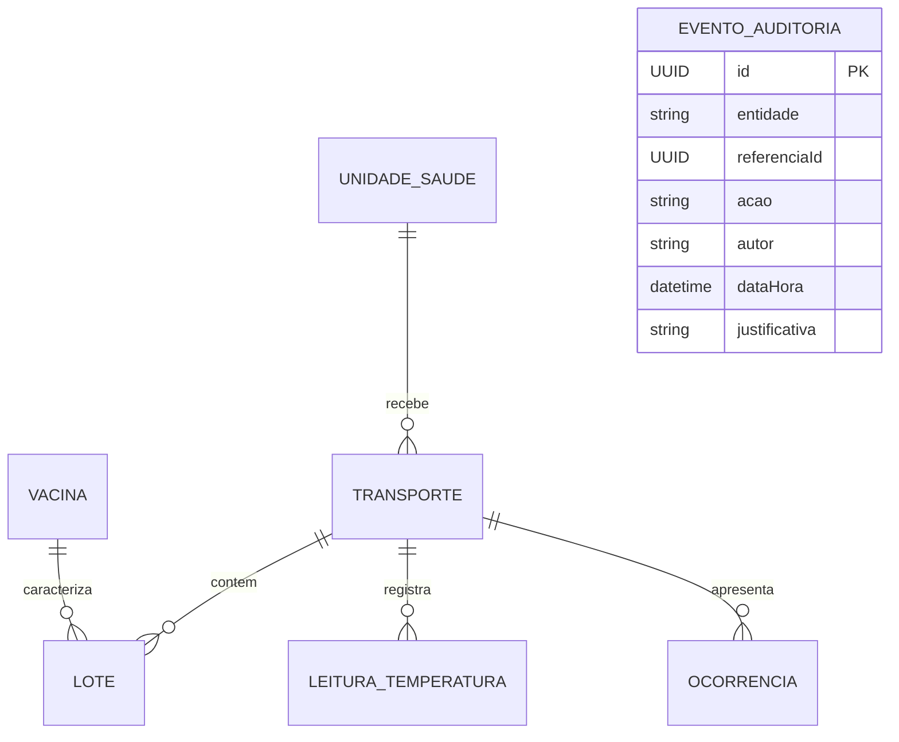

# VaciSmart — API Java
Protótipo acadêmico FIAP Global Solution 2026/2 (CitizenTech) de monitoramento térmico de lotes de vacinas em transporte simulado, bloqueio preventivo e informação de disponibilidade ao cidadão. Dados fictícios: não é sistema clínico nem autoriza aplicação real.

## Problema, beneficiário e ODS
O projeto demonstra como registrar ocorrências térmicas e apoiar a conferência humana, oferecendo ao cidadão informação de disponibilidade sem reserva ou garantia de dose. Beneficiário final: cidadão; usuários operacionais: funcionário de unidade e gestor. ODS principal 3 (Saúde e Bem-Estar); secundários 9 e 10.

## Equipe
| Nome | RM | Turma |
|---|---|---|
| A preencher | A preencher | A preencher |

## Pitch
Link: a preencher.

## Como executar
Pré-requisitos: JDK 21, Docker Engine e Docker Compose, porta 5432 disponível e acesso ao Maven Central no primeiro uso. O Maven Wrapper fixa Maven 3.9.11. Spring Boot 4.1.2 ([versão estável](https://spring.io/projects/spring-boot/), [compatibilidade Java](https://docs.spring.io/spring-boot/system-requirements.html)); decisões em DUVIDAS.md.

Configure JAVA_HOME para um **JDK completo** 21 (java e javac) e adicione `$JAVA_HOME/bin` ao PATH, somente na sessão atual. Exemplo (substitua o caminho pela sua instalação):
```bash
export JAVA_HOME=/caminho/do/jdk-21
export PATH="$JAVA_HOME/bin:$PATH"
```

Na raiz:
```bash
cp .env.example .env
# Revise .env: os valores fornecidos são exemplos exclusivos do desenvolvimento local.
docker compose -f compose.dev.yml up -d
docker compose -f compose.dev.yml ps
./mvnw test
# Exporte as mesmas variáveis para o Spring (Compose não as exporta para a API).
set -a
. ./.env
set +a
./mvnw spring-boot:run -Dspring-boot.run.profiles=dev
```
O arquivo .env deve conter somente atribuições de variáveis confiáveis; o comando acima o executa no shell. A API também aceita DB_URL, DB_USER e DB_PASSWORD já exportadas. Defaults de exemplo existem somente no perfil dev. Não há perfil padrão nem credenciais de produção. API operacional em http://127.0.0.1:8080/api/v1; 404 é esperado na raiz. O servidor fica vinculado a 127.0.0.1 para testes locais até a J4. Não disponibilizar por proxy/túnel nem publicar a API sem segurança.

O perfil dev usa PostgreSQL, Flyway e `ddl-auto=validate`. `V0__baseline.sql` contém somente comentário e foi preservada. `V1__modela_nucleo_termico.sql` cria as sete tabelas do núcleo, chaves estrangeiras, checks e índices; não há seed automático na J2. O perfil test usa H2 em memória (modo PostgreSQL), sem Flyway e `create-drop`. Fuso America/Sao_Paulo e JSON com datas ISO-8601. Nunca usar as credenciais de exemplo fora do ambiente local.

Para parar sem apagar o volume:
```bash
docker compose -f compose.dev.yml down
```

## Estrutura
`pom.xml` e Maven Wrapper na raiz; código em `src/main/java/br/com/fiap/vacismart`; pacotes config, domain (entity, enums, rules), repository, service, web (controller, dto, advice), security. Domínio, repositories, service e config implementam o núcleo J2; web contém Controllers, DTOs e Advice da J3. security permanece reservado. Especificação em [docs/ESPECIFICACAO.md](docs/ESPECIFICACAO.md); governança em [AGENTS.md](AGENTS.md); decisões em [DUVIDAS.md](DUVIDAS.md).

## Entidades e relacionamentos
A J2 modela UnidadeSaude, Vacina, Transporte, Lote, LeituraTemperatura, Ocorrencia e EventoAuditoria com UUID gerado pelo Hibernate. `Entidade` centraliza somente o identificador. Nomes de tabelas/colunas seguem snake_case. Os estados e a disponibilidade são enums persistidos como STRING.



Os vínculos são unidirecionais do lado N para 1. Auditoria identifica o objeto por entidade e referenciaId, sem FK polimórfica. Cada leitura guarda transporte, dispositivoId textual, temperaturaC, medidaEm, recebidaEm e classificação agregada; não há entidade Dispositivo nem integração com hardware.

`Vacina` guarda temperaturaMinC, temperaturaMaxC e margemAtencaoC. `Transporte.inicioMonitoramentoEm` é a referência para detectar silêncio antes da primeira leitura. Auditoria não tem setters, é marcada `@Immutable` e tem colunas não atualizáveis; o serviço somente insere eventos. Não há operação pública de alteração/exclusão de auditoria. A proteção contra SQL direto e políticas de retenção ficam para a infraestrutura futura.

### Regras implementadas na J2

- `MonitoramentoService.iniciarMonitoramento`: CADASTRADO → EM_TRANSPORTE, exige pelo menos um lote e registra auditoria SISTEMA. Ação de simulação, exposta localmente por POST /api/v1/transportes/{id}/monitoramento na J3, ainda sem autenticação.
- `registrarLeitura`: aceita somente EM_TRANSPORTE; valida dispositivo, decimal e medição entre o início do monitoramento e o recebimento. Persiste a leitura e classifica cada vacina usando BigDecimal.compareTo. Aceita medições atrasadas dentro desse intervalo; telemetria considera recebimento.
- Demo A: NORMAL de 3 a 7 inclusive, ATENCAO de 2 a menos de 3 ou acima de 7 até 8, FORA_DA_FAIXA abaixo de 2 ou acima de 8. A atenção fica registrada na classificação e não bloqueia.
- Faixas por vacina: min < max, margem >= 0 e 2 × margem <= max − min. Valores numeric(10,3), até sete dígitos inteiros e três decimais, são validados antes de persistir para impedir arredondamento que altere a classificação. Não se fixam faixas universais.
- Transporte misto: uma leitura do sensor representa o ambiente compartilhado. Cada lote é avaliado com os parâmetros da sua vacina. A classificação persistida da leitura é a mais grave encontrada; somente lotes cuja vacina estiver FORA_DA_FAIXA e cujo estado for EM_MONITORAMENTO são bloqueados. Auditoria identifica cada lote afetado. A classificação agregada não deve ser usada futuramente para decidir todos os lotes. Não se deduz a temperatura individual de cada embalagem.
- Desvio abre no máximo uma ocorrência ABERTA por tipo/transporte. Normalização não encerra a ocorrência térmica nem libera lotes; novos desvios não repetem o evento de bloqueio de lote já bloqueado. Nunca há descarte automático ou conclusão clínica.
- `encerrarOcorrencia`: encerra uma aberta com justificativa e auditoria SISTEMA, sem mudar lote ou disponibilidade. É operação interna, sem decisão técnica nem autenticação nesta etapa.
- `verificarPerdaTelemetria`: método explícito, sem agendador. Mais de três minutos desde o último recebimento (ou início sem leituras) abre PERDA_DE_TELEMETRIA. Exatamente três minutos não abre. Parâmetro `vacismart.telemetria.limite` aceita duração ISO-8601 positiva, padrão `PT3M`. O retorno booleano informa se uma ocorrência nova foi criada. Telemetria sozinha não bloqueia lotes. Retomada de leitura válida encerra somente essa ocorrência e audita; não libera lote nem confirma disponibilidade.
- Todas as operações do serviço são transacionais. Lock pessimista na linha de Transporte serializa início, leituras, encerramento e verificação. Índice único parcial no PostgreSQL reforça a unicidade de ocorrências abertas. Testes H2 verificam também concorrência e rollback.

Recebimento, decisões técnicas, aplicação, confirmação de disponibilidade e transições posteriores continuam pendentes. Enums desses estados estão modelados; não há métodos para executá-los nesta J2.

## Usuários de teste por papel
| Papel | Usuário fictício |
|---|---|
| CIDADAO | A preencher em J4 |
| FUNCIONARIO | A preencher em J4 |
| GESTOR | A preencher em J4 |
O dispositivo terá credencial própria; não é usuário. Nenhum usuário ou autenticação implementado agora.

## Endpoints
A J3 implementa os endpoints operacionais locais detalhados adiante, com prefixo /api/v1. Rotas de cidadão, recebimento e decisão continuam pendentes.

## Justificativas: consultas, cascade e fetch
Todos os `@ManyToOne` são LAZY e obrigatórios, evitando carregar a cadeia inteira em consultas simples. Não há cascade: unidades, vacinas, transportes, lotes, leituras e ocorrências têm ciclos próprios; salvar/remover um filho não deve salvar/remover seus pais nem apagar histórico. Repositories salvam as referências explicitamente. A consulta de lotes usa `@EntityGraph(attributePaths = "vacina")` porque a classificação precisa dos parâmetros de todas as vacinas, evitando N+1 nesse fluxo. Open-in-view permanece desabilitado.

Sete interfaces estendem JpaRepository. As consultas derivadas do núcleo J2 atendem lotes por transporte, leituras por transporte/último recebimento, ocorrências por transporte/tipo/estado e auditoria por referência. Uma JPQL com `PESSIMISTIC_WRITE` busca o transporte por UUID para serializar as regras. A J3 acrescenta consultas paginadas, JPQL de ocorrências e Specifications de lotes/transportes, detalhadas adiante. Entidades não são contratos HTTP; records específicos definem entradas e saídas.

## Testes
Execute `./mvnw -B test` com JDK 21 completo. A suíte contém teste de contexto, testes isolados do classificador e integração do serviço/repositories com `@SpringBootTest`, perfil test e H2. Os testes controlam `Clock`, sem Thread.sleep, e cobrem limites, parâmetros inválidos, transporte misto, persistência, auditoria, bloqueio seletivo, ausência de liberação/descarte automático, duplicidade sequencial/concorrente, rollback e perda de telemetria.

T01–T03 e T09 têm cobertura de domínio nesta J2. T04–T08/T10 dependem de etapas posteriores, HTTP e/ou segurança. H2 usa create-drop com Flyway desabilitado: não valida V1, o índice parcial ou compatibilidade integral com PostgreSQL. Evidências históricas da J1/J2 e resultados atuais da J3 aparecem separados abaixo.

## Limitações e escopo
J1 entregou bootstrap; J2 acrescentou domínio, persistência e regras térmicas; J3 acrescenta REST, validação, paginação e filtros. Sem seed, Security, JWT ou OpenAPI; J4 segurança; J5 documentação OpenAPI. Compose final API + banco e implantação Azure ficam com DevOps.
Spring Cache, Spring HATEOAS e Spring Actuator são requisitos oficiais previstos para próximas etapas, sem implementação ou dependências nesta J2. A orientação inicial de dispensa foi corrigida pelo solicitante (D-007). Não implementar GPS, rota/coordenadas, agendamento/reserva, push/e-mail/SMS, integração SUS/RNDS, QR Code, mapa de surtos ou IA. A especificação da API prevalece sobre os materiais de referência.

## Declaração de uso de IA
Codex foi usado na J1 para estrutura/configuração/documentação e, na J2, para consultar o blogBackend, implementar domínio, regras, testes e documentação e executar as validações relatadas abaixo. Na J3 foi usado para implementar e testar a API REST, consultas e documentação. Claude: ferramenta indicada pelo solicitante; não houve uso de Claude verificável nesta execução. A equipe deve complementar apenas com seu uso real e registrar a revisão humana realizada; não há declaração de revisão humana já concluída.

## Status por funcionalidade
| Funcionalidade | Status |
|---|---|
| Bootstrap Maven/Java 21, perfis e pacotes | Criado |
| PostgreSQL local / Flyway baseline | Configurado; validação abaixo |
| Governança e especificação | Criadas |
| Contexto no perfil test | Validação abaixo |
| Entidades, repositories, regras térmicas e auditoria (J2) | Implementados; evidências abaixo |
| Seed automático | Não implementado na J2; dados fictícios nas fixtures de testes |
| CRUD HTTP e consultas avançadas (J3) | Implementados; regressões abaixo |
| Spring Cache, HATEOAS e Actuator | Previstos para próximas etapas, fora da J2 |
| Segurança (J4) | Pendente |
| OpenAPI (J5) | Pendente |
| Compose final / Azure | Pendente — DevOps |

## Evidências históricas de execução da J1
Em 06/11/2026:
- Maven Wrapper gerado pelo plugin oficial 3.3.4, tipo only-script, fixando Maven 3.9.11.
- A instalação `/usr/lib/jvm/java-21-openjdk-amd64` continha runtime 21, mas não javac; primeira tentativa de teste falhou com `release version 21 not supported` ao recorrer ao compilador 17.
- Usado Eclipse Temurin 21.0.13+9 temporariamente em `/tmp/vacismart-jdk21`, baixado pela API oficial Adoptium, com SHA-256 verificado. Nenhum Java instalado, JAVA_HOME global ou configuração de sistema foi alterado. Esse caminho é temporário e não é pré-requisito permanente.
- Antes dos testes: `java -version` = Temurin 21.0.13; `javac -version` = 21.0.13; `./mvnw -version` = Maven 3.9.11 com runtime Temurin 21.0.13.
- `JAVA_HOME=/tmp/vacismart-jdk21 PATH=/tmp/vacismart-jdk21/bin:$PATH ./mvnw -B test`: **BUILD SUCCESS**, 1 teste, 0 falhas, 0 erros e 0 ignorados; contexto no perfil test com H2. Houve avisos não fatais de processamento de anotações e de autoanexação do agente Mockito/Byte Buddy no Java 21.
- `docker compose -f compose.dev.yml config --quiet`: passou.
- `docker compose -f compose.dev.yml up -d --wait`: falhou; daemon Docker indisponível (`/var/run/docker.sock` ausente no ambiente com execução autorizada). CLI Docker 29.9.0 e Compose v5.5.1 estão presentes. PostgreSQL e migration V0 **não validados em execução**.
- `./mvnw spring-boot:run -Dspring-boot.run.profiles=dev`: não executado por falta do PostgreSQL. Após disponibilizar o daemon, repetir os passos de execução acima.
- `git diff --check`: passou; `.env` e `target` são ignorados; especificação conferida por igualdade integral com o pedido.

Relatório Surefire local: `target/surefire-reports/`. Os logs temporários de validação não são versionados.

## Referência didática da J2

Consultado [blogBackend](https://github.com/opatriarcha/2026_fiap_2tdspa_java_advanced/tree/2f3f5aaba185267023f4aace702fd2a4c6be81cf/blogBackend), commit `2f3f5aaba185267023f4aace702fd2a4c6be81cf`, em cópia temporária fora deste Git. Exemplos lidos: Post, Comment, Order, CommentRepository, CommentService, AbstractCrudService, CommentServiceTest, CustomRepositoriesIntegrationTest e pom.xml. Foram aproveitados os conceitos de UUID, mapeamentos, Bean Validation, JpaRepository, injeção por construtor, transações em serviços e separação de testes isolados/integração. As classes foram criadas para o domínio VaciSmart.

Diferenças: mantemos Boot 4.1.2 e a estrutura de pacotes existente; o exemplo usa 4.1.0 e CRUD genérico. Aqui o serviço coordena regras específicas, usa BigDecimal para temperaturas, referências LAZY sem cascade e auditoria por evento. Post usa ManyToOne sem fetch explícito; Comment explicita LAZY e usa remoção por cascade no banco, que não se aplica ao nosso histórico. Order demonstra CascadeType.ALL, não adotado. QueryDSL, JWT e JaCoCo do exemplo não foram adicionados.

## Evidências históricas da J2 — 08/11/2026

JDK temporário `/tmp/vacismart-jdk21` (Temurin 21.0.13), Maven Wrapper 3.9.11, Boot 4.1.2, perfil test/H2. Nenhuma versão ou perfil alterado. Comando de cada rodada independente:

```bash
JAVA_HOME=/tmp/vacismart-jdk21 PATH=/tmp/vacismart-jdk21/bin:$PATH ./mvnw -B test
```

| Rodada | Testes | Falhas | Erros | Ignorados | Resultado | Duração Maven | Conclusão (America/Sao_Paulo) |
|---|---|---|---|---|---|---|---|
| 1 | 45 | 0 | 0 | 0 | BUILD SUCCESS | 14.871 s | 2026-11-08T00:56:43-03:00 |
| 2 | 45 | 0 | 0 | 0 | BUILD SUCCESS | 11.321 s | 2026-11-08T00:59:35-03:00 |
| 3 | 45 | 0 | 0 | 0 | BUILD SUCCESS | 11.353 s | 2026-11-08T00:59:47-03:00 |

Execução preliminar anterior ao ajuste de normalização decimal: BUILD SUCCESS, 43 testes, zero falhas/erros/ignorados. As três rodadas acima incluem o código final e os casos adicionais de `5.2000`. Logs locais em `/tmp/vacismart-j2-inicial.log` e `/tmp/vacismart-j2-regressao-{1,2,3}.log`; Surefire em `target/surefire-reports/`. Avisos não fatais: processamento de anotações e agente Mockito/Byte Buddy no Java 21.

`git diff --check` passou. Especificação, pom, application.yml e V0 comparados com 7e60863: sem alterações. PostgreSQL, aplicação das migrations V0+V1, checks/índice parcial e startup dev continuam não testados operacionalmente; não foi alterado banco real, Azure ou produção. A J2 está pronta para revisão do domínio com essa pendência explícita.

## API REST operacional — J3

**Uso exclusivamente local, sem autenticação ou autorização até a J4.** Bind padrão 127.0.0.1. Nenhuma configuração de CORS irrestrito. Os papéis da especificação ainda não estão protegidos; não há API pública de dados internos. Não publicar, criar proxy/túnel ou implantar na Azure nesta etapa.

Arquitetura: Controller recebe/valida → Service transacional aplica regras e mapeia DTOs → Repository consulta/persiste. Os Controllers não classificam temperatura. `OperacaoTransporteController` chama diretamente `MonitoramentoService.registrarLeitura`; a entidade retornada é convertida em `LeituraSaidaDto`, nunca serializada. Demais consultas mapeiam dentro da transação, com open-in-view desabilitado. Relacionamentos seguem LAZY/sem cascade; DTOs usam somente os IDs dos vínculos, sem carregar nomes de pais. O EntityGraph da J2 continua atendendo a classificação térmica.

Todas as rotas abaixo recebem o prefixo `/api/v1`. Todos os IDs são UUID. GET nunca altera estado. POST de criação retorna 201, corpo e Location relativo resolvível; PUT retorna 200 e corpo; DELETE permitido e início de monitoramento retornam 204 sem corpo.

| Método | Rota | Entrada ou consulta | Regra / saída |
|---|---|---|---|
| POST | /unidades | nome | Cria unidade; UnidadeSaidaDto |
| GET | /unidades | page, size, sort | Página de unidades |
| GET | /unidades/{id} | — | UnidadeSaidaDto |
| PUT | /unidades/{id} | nome | Atualiza nome |
| DELETE | /unidades/{id} | — | Somente sem transportes/histórico |
| POST | /vacinas | nome, temperaturaMinC, temperaturaMaxC, margemAtencaoC | Cria vacina; VacinaSaidaDto |
| GET | /vacinas | page, size, sort | Página de vacinas |
| GET | /vacinas/{id} | — | VacinaSaidaDto |
| PUT | /vacinas/{id} | mesmos campos de criação | Faixa só muda se não existirem lotes; nome pode mudar |
| DELETE | /vacinas/{id} | — | Somente sem lotes/histórico |
| POST | /transportes | codigo, unidadeSaudeId | Estado inicial CADASTRADO |
| GET | /transportes | unidadeId, estado, page, size, sort | Página com filtros combináveis |
| GET | /transportes/{id} | — | TransporteSaidaDto |
| PUT | /transportes/{id} | codigo, unidadeSaudeId | Somente CADASTRADO |
| DELETE | /transportes/{id} | — | Somente CADASTRADO sem lotes/leituras/ocorrências/histórico |
| POST | /transportes/{id}/monitoramento | Sem corpo | Regra da J2: exige lotes, muda para EM_TRANSPORTE e audita |
| POST | /lotes | codigo, vacinaId, transporteId | Transporte CADASTRADO; EM_MONITORAMENTO/NAO_DISPONIVEL |
| GET | /lotes | transporteId, vacinaId, estado, page, size, sort | Página com filtros combináveis |
| GET | /lotes/{id} | — | LoteSaidaDto |
| PUT | /lotes/{id} | codigo | Somente EM_MONITORAMENTO com transporte CADASTRADO; vínculos imutáveis |
| GET | /lotes/{id}/historico | page, size, sort | Auditoria somente do lote identificado |
| POST | /transportes/{id}/leituras | transporteId, dispositivoId, temperaturaC, medidaEm | transporteId obrigatório e igual à rota; regra térmica J2 |
| GET | /transportes/{id}/leituras | page, size, sort | Página de leituras do transporte |
| GET | /transportes/{id}/leituras/{leituraId} | — | Leitura somente se pertencer ao transporte |
| GET | /transportes/{id}/ocorrencias | estado, page, size, sort | Página de ocorrências; JPQL |
| GET | /transportes/{id}/historico | page, size, sort | Auditoria somente da entidade Transporte; eventos dos lotes são consultados nos respectivos lotes |

Sem DELETE de lotes, CRUD de auditoria ou escrita em ocorrências. Sem endpoints de login, cidadão, recebimento, decisão técnica, disponibilidade, aplicação de doses, liberação ou descarte. Verificação de perda de telemetria e encerramento de ocorrências continuam métodos internos da J2, sem endpoint/agendador nesta J3.

### Validações e preservação do histórico

Entradas e saídas são records diferentes. Campos desconhecidos no JSON são rejeitados com 400, incluindo `estado`, `disponibilidade`, `autor`, `id` e classificações calculadas quando não pertencem ao DTO de entrada. `@NotBlank`/`@Size` limitam nome a 150, código a 60 e dispositivoId a 100 caracteres. `@NotNull` exige referências e dados de leitura. `@DecimalMin`/`@DecimalMax` delimitam numeric(10,3); `Validacoes.decimal` preserva a validação exata da J2 sem arredondar (aceita 5.2000, rejeita 8.0001). `Validacoes.faixa` exige min < max, margem >= 0 e 2 × margem <= max − min. A margem deve ser informada explicitamente (demo: 1).

A prioridade da classificação é explícita: NORMAL=0, ATENCAO=10, FORA_DA_FAIXA=20. `maisGraveQue` usa esse valor, sem ordinal e sem alterar parâmetros térmicos. A comparação continua estrita: classificações iguais não substituem a atual.

Faixas de vacinas com lotes ficam congeladas, inclusive antes do início, para impedir reinterpretação de avaliações existentes. Renomear a vacina é permitido com parâmetros numericamente iguais. Lote só permite corrigir código antes do monitoramento; vacina/transporte não podem ser trocados. Cadastro de novos lotes após o início retorna 409. Código de lote/transporte é único; colisão retorna 409. Atualizações cadastrais não mudam estados; transições existentes continuam auditadas pela J2, com autor SISTEMA na simulação.

Locks pessimistas de unidade e vacina serializam exclusão/alteração com criação de referências; operações de lote/transporte usam o lock do transporte já adotado no monitoramento. FKs/uniqueness permanecem como proteção adicional. SQL direto e concorrência no PostgreSQL real não são comprovados pelos testes H2. Criar/editar/excluir referências é responsabilidade do Service, sem cascade de remoção.

### Paginação, ordenação e filtros

Todas as listagens usam `Pageable` e paginação no banco; nenhuma carrega tudo para paginar em memória. `page` inicia em 0; padrão `size=20`, máximo 100 (valores maiores são limitados a 100). O resolver padrão Spring Data normaliza page negativo/inválido para 0 e size inválido/não positivo para o padrão. `sort=campo,asc` ou `sort=campo,desc`, repetível. Sem sort, ordena por id; id também desempata outras ordenações. Não implica ordem cronológica: use os campos de data quando necessário. Campo fora da lista abaixo retorna 400.

| Recurso | Campos permitidos em sort |
|---|---|
| unidades, vacinas | id, nome |
| transportes | id, codigo, estado, inicioMonitoramentoEm |
| lotes | id, codigo, estado |
| leituras | id, medidaEm, recebidaEm, temperaturaC, classificacao |
| ocorrências | id, abertaEm, encerradaEm, tipo, estado |
| histórico | id, dataHora, acao |

Exemplo: `GET /api/v1/lotes?transporteId={uuid}&vacinaId={uuid}&estado=EM_MONITORAMENTO&page=0&size=10&sort=codigo,asc`. Filtros opcionais combinam com AND; ausência de resultados retorna página vazia. UUID de filtro sem correspondência também retorna página vazia. Já consultar um recurso ou seus filhos por uma rota cujo ID não existe retorna 404.

Formato próprio, estável, sem metadados internos do PageImpl:
```json
{"conteudo":[{"id":"11111111-1111-1111-1111-111111111111","nome":"Unidade Demonstrativa 01"}],"pagina":0,"tamanho":20,"totalElementos":1,"totalPaginas":1}
```

### Consultas JPA justificadas

- Derivadas: `findByTransporteId(UUID, Pageable)` lista leituras de um transporte; `findByEntidadeAndReferenciaId` consulta auditoria do recurso; `existsByVacinaId` e `existsByUnidadeSaudeId` protegem dependências sem carregar coleções.
- JPQL: `OcorrenciaRepository.consultarPorTransporte` filtra por transporte e, opcionalmente, estado. Permite inspeção operacional de abertas/encerradas com a mesma consulta paginada e contagem no banco. JPQL usa parâmetros e não concatena entradas do usuário. A JPQL de lock da J2 permanece.
```java
@Query("select o from Ocorrencia o where o.transporte.id = :transporteId "
        + "and (:estado is null or o.estado = :estado)")
Page<Ocorrencia> consultarPorTransporte(UUID transporteId, EstadoOcorrencia estado, Pageable pageable);
```
- `Specification`: `Filtros.lotes` combina transporteId, vacinaId e estado; `Filtros.transportes` combina unidadeId e estado. Evita a multiplicação de métodos para cada combinação e aplica filtros/ordenação/paginação no SQL. Nenhum QueryDSL acrescentado.

### Exemplos HTTP locais

Os UUIDs e horários abaixo são ilustrativos. Substitua pelos IDs retornados pelos cadastros. Cadastre unidade → vacina → transporte → lote; inicie monitoramento; só então envie leitura com medidaEm entre o início retornado pelo GET do transporte e o instante atual, sempre com offset.

```http
POST /api/v1/unidades
Content-Type: application/json

{"nome":"Unidade Demonstrativa 01"}
```
```http
HTTP/1.1 201 Created
Location: /api/v1/unidades/11111111-1111-1111-1111-111111111111

{"id":"11111111-1111-1111-1111-111111111111","nome":"Unidade Demonstrativa 01"}
```
```http
POST /api/v1/vacinas
Content-Type: application/json

{"nome":"Vacina Demo A","temperaturaMinC":2.0,"temperaturaMaxC":8.0,"margemAtencaoC":1.0}

POST /api/v1/transportes
Content-Type: application/json

{"codigo":"TRP-001","unidadeSaudeId":"11111111-1111-1111-1111-111111111111"}

POST /api/v1/lotes
Content-Type: application/json

{"codigo":"VAC-2026-001","vacinaId":"22222222-2222-2222-2222-222222222222","transporteId":"33333333-3333-3333-3333-333333333333"}

POST /api/v1/transportes/33333333-3333-3333-3333-333333333333/monitoramento
```
Resposta do início: `204 No Content`. A leitura mantém o campo transporteId do exemplo da especificação, conferido contra a rota:
```http
POST /api/v1/transportes/33333333-3333-3333-3333-333333333333/leituras
Content-Type: application/json

{"transporteId":"33333333-3333-3333-3333-333333333333","dispositivoId":"ARDUINO-DEMO-01","temperaturaC":9.3,"medidaEm":"2026-11-10T14:20:30-03:00"}
```
```http
HTTP/1.1 201 Created
Location: /api/v1/transportes/33333333-3333-3333-3333-333333333333/leituras/44444444-4444-4444-4444-444444444444

{"id":"44444444-4444-4444-4444-444444444444","transporteId":"33333333-3333-3333-3333-333333333333","dispositivoId":"ARDUINO-DEMO-01","temperaturaC":9.3,"medidaEm":"2026-11-10T14:20:30-03:00","recebidaEm":"2026-11-10T14:20:31-03:00","classificacao":"FORA_DA_FAIXA"}
```
Os offsets de saída podem ser normalizados pelo serializador para o mesmo instante; não depender da representação textual exata do offset. A consulta posterior do lote afetado devolve BLOQUEADO_PREVENTIVAMENTE e NAO_DISPONIVEL. 5.2 classifica NORMAL e 7.5 ATENCAO; nenhuma libera/descarta. No transporte misto só bloqueia os lotes fora da faixa da respectiva vacina. Normalização não encerra ocorrência térmica nem libera lote.

### Respostas de erro

`ErroApiAdvice` estende ResponseEntityExceptionHandler e usa `application/problem+json` (`ProblemDetail`). 400: Bean Validation, JSON/campo desconhecido, UUID/enum/data inválidos, faixa/precisão inválida ou transporteId divergente da rota. 404: recurso/referência inexistente. 409: estado incompatível, duplicidade, dependências ou concorrência. 405: método HTTP não permitido. 500: resposta genérica segura, sem stack trace ou detalhes de persistência. Erros MVC como 415 preservam seu código adequado. Não há 401/403 funcional nesta J3 sem autenticação.

```json
{"type":"about:blank","title":"Conflict","status":409,"detail":"Lote já possui monitoramento","instance":"/api/v1/lotes/55555555-5555-5555-5555-555555555555"}
```
Validação de DTO acrescenta `campos`, por exemplo `[{"campo":"nome","mensagem":"não deve estar em branco"}]` (mensagem depende do idioma do Validator). Erro inesperado usa `detail="Erro interno ao processar a requisição"`.

### Testes e limites da J3

Testes HTTP usam `@SpringBootTest(RANDOM_PORT)`, JDK HttpClient, Jackson 3, Clock fixo e H2 separado (`vacismart-http`), passando por Controller → Service → Repository real, sem mocks de domínio. Não exigem nova dependência de testes. O controlador de falha inesperada existe somente em src/test e não entra no JAR.

Total final: 89 testes (45 da J2 preservados + 12 de prioridade explícita + 32 HTTP). Cobrem criação/Location/consulta, DTO inválido, UUID/enum/datas inválidos, 404, atualizações permitidas/proibidas, faixa congelada, rollback, duplicidade, paginação/ordenação/limite, Specifications, JPQL, 5.2/7.5/9.3, bloqueio/auditoria, normalização sem liberação/descarte, transporte misto, exclusão protegida, GET sem transição e histórico somente leitura, além de 500 seguro. Primeiro teste após a correção: 57/0/0/0; implementação inicial com HTTP: 86/0/0/0; preliminar final: 89/0/0/0. Todos BUILD SUCCESS.

PostgreSQL real, Flyway V0/V1, checks/índice parcial e startup dev continuam pendentes de validação operacional. Os testes H2 usam create-drop/Flyway desabilitado e não comprovam esses itens. Não houve acesso a banco real, deploy, push ou avanço à J4.

### Regressões finais independentes da J3 — 08/11/2026

Cada rodada iniciou novo processo Maven/JVM com o código final:
```bash
JAVA_HOME=/tmp/vacismart-jdk21 PATH=/tmp/vacismart-jdk21/bin:$PATH ./mvnw -B test
```

| Rodada | Testes | Falhas | Erros | Ignorados | Resultado | Duração Maven | Conclusão (America/Sao_Paulo) |
|---|---|---|---|---|---|---|---|
| 1 | 89 | 0 | 0 | 0 | BUILD SUCCESS | 17.187 s | 2026-11-08T22:47:57-03:00 |
| 2 | 89 | 0 | 0 | 0 | BUILD SUCCESS | 16.076 s | 2026-11-08T22:48:15-03:00 |
| 3 | 89 | 0 | 0 | 0 | BUILD SUCCESS | 16.016 s | 2026-11-08T22:48:33-03:00 |

Compilação e empacotamento: `./mvnw -B -DskipTests package`, com o mesmo JDK 21, BUILD SUCCESS; testes omitidos somente nesse comando após as três regressões completas. Artefato local: `target/vacismart-java-api-0.0.1-SNAPSHOT.jar`. Logs em `/tmp/vacismart-j3-regressao-{1,2,3}.log` e `/tmp/vacismart-j3-package.log`; Surefire em target/surefire-reports. Avisos não fatais de annotation processing e Mockito/Byte Buddy persistem.
