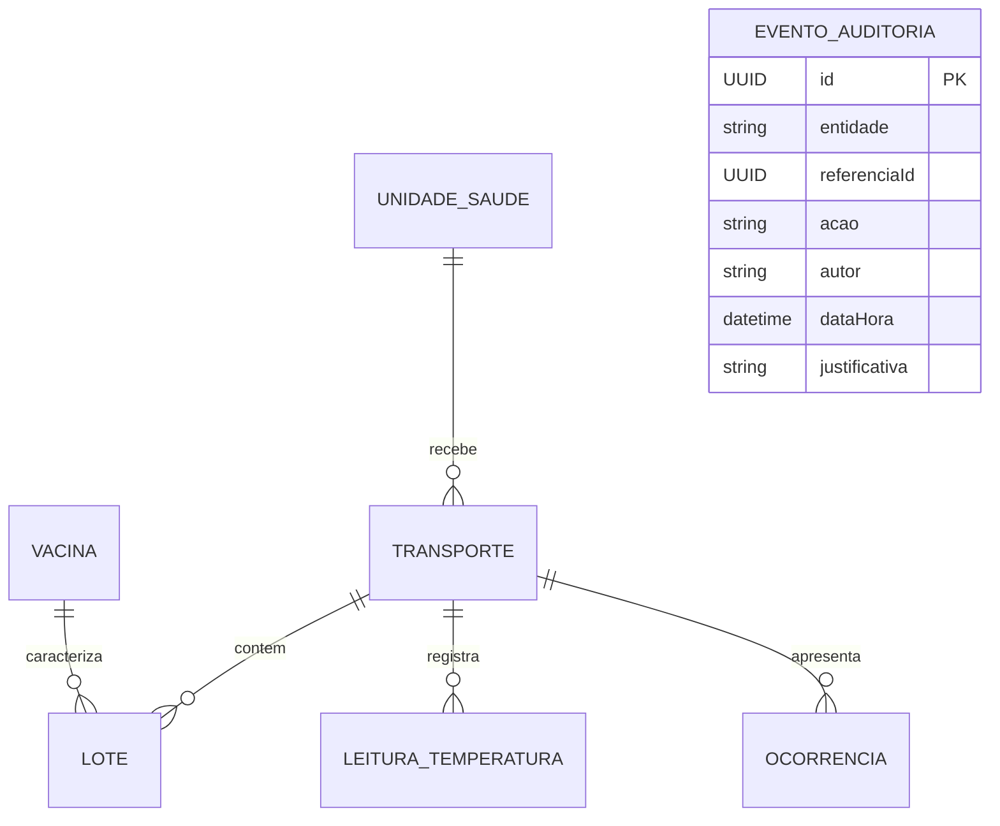

# VaciSmart — API Java
Protótipo acadêmico FIAP Global Solution 2026/2 (CitizenTech) de monitoramento térmico de lotes de vacinas em transporte simulado, bloqueio preventivo e informação de disponibilidade ao cidadão. Dados fictícios: não é sistema clínico nem autoriza aplicação real.

## Problema, beneficiário e ODS
O projeto demonstra como registrar ocorrências térmicas e apoiar a conferência humana, oferecendo ao cidadão informação de disponibilidade sem reserva ou garantia de dose. Beneficiário final: cidadão; usuários operacionais: funcionário de unidade e gestor. ODS principal 3 (Saúde e Bem-Estar); secundários 9 e 10.

## Equipe
| Nome | RM | Turma |
|---|---|---|
| A preencher | A preencher | A preencher |

## Pitch
Link: a preencher.

## Como executar
Pré-requisitos: JDK 21, Docker Engine e Docker Compose, porta 5432 disponível e acesso ao Maven Central no primeiro uso. O Maven Wrapper fixa Maven 3.9.11. Spring Boot 4.1.2 ([versão estável](https://spring.io/projects/spring-boot/), [compatibilidade Java](https://docs.spring.io/spring-boot/system-requirements.html)); decisões em DUVIDAS.md.

Configure JAVA_HOME para um **JDK completo** 21 (java e javac) e adicione `$JAVA_HOME/bin` ao PATH, somente na sessão atual. Exemplo (substitua o caminho pela sua instalação):
```bash
export JAVA_HOME=/caminho/do/jdk-21
export PATH="$JAVA_HOME/bin:$PATH"
```

Na raiz:
```bash
cp .env.example .env
# Revise .env: os valores fornecidos são exemplos exclusivos do desenvolvimento local.
docker compose -f compose.dev.yml up -d
docker compose -f compose.dev.yml ps
./mvnw test
# Exporte as mesmas variáveis para o Spring (Compose não as exporta para a API).
set -a
. ./.env
set +a
./mvnw spring-boot:run -Dspring-boot.run.profiles=dev
```
O arquivo .env deve conter somente atribuições de variáveis confiáveis; o comando acima o executa no shell. A API também aceita DB_URL, DB_USER e DB_PASSWORD já exportadas. Defaults de exemplo existem somente no perfil dev. Não há perfil padrão nem credenciais de produção. API em http://localhost:8080, sem endpoints de negócio nesta etapa (404 é esperado na raiz).

O perfil dev usa PostgreSQL, Flyway e `ddl-auto=validate`. `V0__baseline.sql` contém somente comentário e foi preservada. `V1__modela_nucleo_termico.sql` cria as sete tabelas do núcleo, chaves estrangeiras, checks e índices; não há seed automático na J2. O perfil test usa H2 em memória (modo PostgreSQL), sem Flyway e `create-drop`. Fuso America/Sao_Paulo e JSON com datas ISO-8601. Nunca usar as credenciais de exemplo fora do ambiente local.

Para parar sem apagar o volume:
```bash
docker compose -f compose.dev.yml down
```

## Estrutura
`pom.xml` e Maven Wrapper na raiz; código em `src/main/java/br/com/fiap/vacismart`; pacotes config, domain (entity, enums, rules), repository, service, web (controller, dto, advice), security. Domínio, repositories, service e config implementam a J2; web e security continuam reservados com package-info.java. Especificação em [docs/ESPECIFICACAO.md](docs/ESPECIFICACAO.md); governança em [AGENTS.md](AGENTS.md); decisões em [DUVIDAS.md](DUVIDAS.md).

## Entidades e relacionamentos
A J2 modela UnidadeSaude, Vacina, Transporte, Lote, LeituraTemperatura, Ocorrencia e EventoAuditoria com UUID gerado pelo Hibernate. `Entidade` centraliza somente o identificador. Nomes de tabelas/colunas seguem snake_case. Os estados e a disponibilidade são enums persistidos como STRING.



Os vínculos são unidirecionais do lado N para 1. Auditoria identifica o objeto por entidade e referenciaId, sem FK polimórfica. Cada leitura guarda transporte, dispositivoId textual, temperaturaC, medidaEm, recebidaEm e classificação agregada; não há entidade Dispositivo nem integração com hardware.

`Vacina` guarda temperaturaMinC, temperaturaMaxC e margemAtencaoC. `Transporte.inicioMonitoramentoEm` é a referência para detectar silêncio antes da primeira leitura. Auditoria não tem setters, é marcada `@Immutable` e tem colunas não atualizáveis; o serviço somente insere eventos. Não há operação pública de alteração/exclusão de auditoria. A proteção contra SQL direto e políticas de retenção ficam para a infraestrutura futura.

### Regras implementadas na J2

- `MonitoramentoService.iniciarMonitoramento`: CADASTRADO → EM_TRANSPORTE, exige pelo menos um lote e registra auditoria SISTEMA. Ação de simulação interna, sem endpoint ou autorização de usuário nesta etapa.
- `registrarLeitura`: aceita somente EM_TRANSPORTE; valida dispositivo, decimal e medição entre o início do monitoramento e o recebimento. Persiste a leitura e classifica cada vacina usando BigDecimal.compareTo. Aceita medições atrasadas dentro desse intervalo; telemetria considera recebimento.
- Demo A: NORMAL de 3 a 7 inclusive, ATENCAO de 2 a menos de 3 ou acima de 7 até 8, FORA_DA_FAIXA abaixo de 2 ou acima de 8. A atenção fica registrada na classificação e não bloqueia.
- Faixas por vacina: min < max, margem >= 0 e 2 × margem <= max − min. Valores numeric(10,3), até sete dígitos inteiros e três decimais, são validados antes de persistir para impedir arredondamento que altere a classificação. Não se fixam faixas universais.
- Transporte misto: uma leitura do sensor representa o ambiente compartilhado. Cada lote é avaliado com os parâmetros da sua vacina. A classificação persistida da leitura é a mais grave encontrada; somente lotes cuja vacina estiver FORA_DA_FAIXA e cujo estado for EM_MONITORAMENTO são bloqueados. Auditoria identifica cada lote afetado. A classificação agregada não deve ser usada futuramente para decidir todos os lotes. Não se deduz a temperatura individual de cada embalagem.
- Desvio abre no máximo uma ocorrência ABERTA por tipo/transporte. Normalização não encerra a ocorrência térmica nem libera lotes; novos desvios não repetem o evento de bloqueio de lote já bloqueado. Nunca há descarte automático ou conclusão clínica.
- `encerrarOcorrencia`: encerra uma aberta com justificativa e auditoria SISTEMA, sem mudar lote ou disponibilidade. É operação interna, sem decisão técnica nem autenticação nesta etapa.
- `verificarPerdaTelemetria`: método explícito, sem agendador. Mais de três minutos desde o último recebimento (ou início sem leituras) abre PERDA_DE_TELEMETRIA. Exatamente três minutos não abre. Parâmetro `vacismart.telemetria.limite` aceita duração ISO-8601 positiva, padrão `PT3M`. O retorno booleano informa se uma ocorrência nova foi criada. Telemetria sozinha não bloqueia lotes. Retomada de leitura válida encerra somente essa ocorrência e audita; não libera lote nem confirma disponibilidade.
- Todas as operações do serviço são transacionais. Lock pessimista na linha de Transporte serializa início, leituras, encerramento e verificação. Índice único parcial no PostgreSQL reforça a unicidade de ocorrências abertas. Testes H2 verificam também concorrência e rollback.

Recebimento, decisões técnicas, aplicação, confirmação de disponibilidade e transições posteriores continuam pendentes. Enums desses estados estão modelados; não há métodos para executá-los nesta J2.

## Usuários de teste por papel
| Papel | Usuário fictício |
|---|---|
| CIDADAO | A preencher em J4 |
| FUNCIONARIO | A preencher em J4 |
| GESTOR | A preencher em J4 |
O dispositivo terá credencial própria; não é usuário. Nenhum usuário ou autenticação implementado agora.

## Endpoints
A implementar; contrato previsto em docs/ESPECIFICACAO.md com prefixo /api/v1. Nenhuma rota funcional na J2.

## Justificativas: consultas, cascade e fetch
Todos os `@ManyToOne` são LAZY e obrigatórios, evitando carregar a cadeia inteira em consultas simples. Não há cascade: unidades, vacinas, transportes, lotes, leituras e ocorrências têm ciclos próprios; salvar/remover um filho não deve salvar/remover seus pais nem apagar histórico. Repositories salvam as referências explicitamente. A consulta de lotes usa `@EntityGraph(attributePaths = "vacina")` porque a classificação precisa dos parâmetros de todas as vacinas, evitando N+1 nesse fluxo. Open-in-view permanece desabilitado.

Sete interfaces estendem JpaRepository. As consultas derivadas implementadas atendem somente lotes por transporte, leituras por transporte/último recebimento, ocorrências por transporte/tipo/estado e auditoria por referência. Uma JPQL com `PESSIMISTIC_WRITE` busca o transporte por UUID para serializar as regras. Consultas avançadas, filtros dinâmicos e paginação funcional ficam para etapas posteriores. Entidades não são contratos HTTP; DTOs serão definidos quando houver endpoints.

## Testes
Execute `./mvnw -B test` com JDK 21 completo. A suíte contém teste de contexto, testes isolados do classificador e integração do serviço/repositories com `@SpringBootTest`, perfil test e H2. Os testes controlam `Clock`, sem Thread.sleep, e cobrem limites, parâmetros inválidos, transporte misto, persistência, auditoria, bloqueio seletivo, ausência de liberação/descarte automático, duplicidade sequencial/concorrente, rollback e perda de telemetria.

T01–T03 e T09 têm cobertura de domínio nesta J2. T04–T08/T10 dependem de etapas posteriores, HTTP e/ou segurança. H2 usa create-drop com Flyway desabilitado: não valida V1, o índice parcial ou compatibilidade integral com PostgreSQL. Evidências históricas da J1 e evidências atuais da J2 aparecem separadas abaixo.

## Limitações e escopo
J1 entregou bootstrap; J2 acrescenta domínio, persistência e regras térmicas. Sem controllers, CRUD HTTP, seed, Security, JWT ou OpenAPI; J4 segurança; J5 documentação OpenAPI. Compose final API + banco e implantação Azure ficam com DevOps.
Spring Cache, Spring HATEOAS e Spring Actuator são requisitos oficiais previstos para próximas etapas, sem implementação ou dependências nesta J2. A orientação inicial de dispensa foi corrigida pelo solicitante (D-007). Não implementar GPS, rota/coordenadas, agendamento/reserva, push/e-mail/SMS, integração SUS/RNDS, QR Code, mapa de surtos ou IA. A especificação da API prevalece sobre os materiais de referência.

## Declaração de uso de IA
Codex foi usado na J1 para estrutura/configuração/documentação e, na J2, para consultar o blogBackend, implementar domínio, regras, testes e documentação e executar as validações relatadas abaixo. Claude: ferramenta indicada pelo solicitante; não houve uso de Claude verificável nesta execução. A equipe deve complementar apenas com seu uso real e registrar a revisão humana realizada; não há declaração de revisão humana já concluída.

## Status por funcionalidade
| Funcionalidade | Status |
|---|---|
| Bootstrap Maven/Java 21, perfis e pacotes | Criado |
| PostgreSQL local / Flyway baseline | Configurado; validação abaixo |
| Governança e especificação | Criadas |
| Contexto no perfil test | Validação abaixo |
| Entidades, repositories, regras térmicas e auditoria (J2) | Implementados; evidências abaixo |
| Seed automático | Não implementado na J2; dados fictícios nas fixtures de testes |
| CRUD HTTP e consultas avançadas | Pendente |
| Spring Cache, HATEOAS e Actuator | Previstos para próximas etapas, fora da J2 |
| Segurança (J4) | Pendente |
| OpenAPI (J5) | Pendente |
| Compose final / Azure | Pendente — DevOps |

## Evidências históricas de execução da J1
Em 06/11/2026:
- Maven Wrapper gerado pelo plugin oficial 3.3.4, tipo only-script, fixando Maven 3.9.11.
- A instalação `/usr/lib/jvm/java-21-openjdk-amd64` continha runtime 21, mas não javac; primeira tentativa de teste falhou com `release version 21 not supported` ao recorrer ao compilador 17.
- Usado Eclipse Temurin 21.0.13+9 temporariamente em `/tmp/vacismart-jdk21`, baixado pela API oficial Adoptium, com SHA-256 verificado. Nenhum Java instalado, JAVA_HOME global ou configuração de sistema foi alterado. Esse caminho é temporário e não é pré-requisito permanente.
- Antes dos testes: `java -version` = Temurin 21.0.13; `javac -version` = 21.0.13; `./mvnw -version` = Maven 3.9.11 com runtime Temurin 21.0.13.
- `JAVA_HOME=/tmp/vacismart-jdk21 PATH=/tmp/vacismart-jdk21/bin:$PATH ./mvnw -B test`: **BUILD SUCCESS**, 1 teste, 0 falhas, 0 erros e 0 ignorados; contexto no perfil test com H2. Houve avisos não fatais de processamento de anotações e de autoanexação do agente Mockito/Byte Buddy no Java 21.
- `docker compose -f compose.dev.yml config --quiet`: passou.
- `docker compose -f compose.dev.yml up -d --wait`: falhou; daemon Docker indisponível (`/var/run/docker.sock` ausente no ambiente com execução autorizada). CLI Docker 29.9.0 e Compose v5.5.1 estão presentes. PostgreSQL e migration V0 **não validados em execução**.
- `./mvnw spring-boot:run -Dspring-boot.run.profiles=dev`: não executado por falta do PostgreSQL. Após disponibilizar o daemon, repetir os passos de execução acima.
- `git diff --check`: passou; `.env` e `target` são ignorados; especificação conferida por igualdade integral com o pedido.

Relatório Surefire local: `target/surefire-reports/`. Os logs temporários de validação não são versionados.

## Referência didática da J2

Consultado [blogBackend](https://github.com/opatriarcha/2026_fiap_2tdspa_java_advanced/tree/2f3f5aaba185267023f4aace702fd2a4c6be81cf/blogBackend), commit `2f3f5aaba185267023f4aace702fd2a4c6be81cf`, em cópia temporária fora deste Git. Exemplos lidos: Post, Comment, Order, CommentRepository, CommentService, AbstractCrudService, CommentServiceTest, CustomRepositoriesIntegrationTest e pom.xml. Foram aproveitados os conceitos de UUID, mapeamentos, Bean Validation, JpaRepository, injeção por construtor, transações em serviços e separação de testes isolados/integração. As classes foram criadas para o domínio VaciSmart.

Diferenças: mantemos Boot 4.1.2 e a estrutura de pacotes existente; o exemplo usa 4.1.0 e CRUD genérico. Aqui o serviço coordena regras específicas, usa BigDecimal para temperaturas, referências LAZY sem cascade e auditoria por evento. Post usa ManyToOne sem fetch explícito; Comment explicita LAZY e usa remoção por cascade no banco, que não se aplica ao nosso histórico. Order demonstra CascadeType.ALL, não adotado. QueryDSL, JWT e JaCoCo do exemplo não foram adicionados.

## Evidências atuais da J2 — 08/11/2026

JDK temporário `/tmp/vacismart-jdk21` (Temurin 21.0.13), Maven Wrapper 3.9.11, Boot 4.1.2, perfil test/H2. Nenhuma versão ou perfil alterado. Comando de cada rodada independente:

```bash
JAVA_HOME=/tmp/vacismart-jdk21 PATH=/tmp/vacismart-jdk21/bin:$PATH ./mvnw -B test
```

| Rodada | Testes | Falhas | Erros | Ignorados | Resultado | Duração Maven | Conclusão (America/Sao_Paulo) |
|---|---|---|---|---|---|---|---|
| 1 | 45 | 0 | 0 | 0 | BUILD SUCCESS | 14.871 s | 2026-11-08T00:56:43-03:00 |
| 2 | 45 | 0 | 0 | 0 | BUILD SUCCESS | 11.321 s | 2026-11-08T00:59:35-03:00 |
| 3 | 45 | 0 | 0 | 0 | BUILD SUCCESS | 11.353 s | 2026-11-08T00:59:47-03:00 |

Execução preliminar anterior ao ajuste de normalização decimal: BUILD SUCCESS, 43 testes, zero falhas/erros/ignorados. As três rodadas acima incluem o código final e os casos adicionais de `5.2000`. Logs locais em `/tmp/vacismart-j2-inicial.log` e `/tmp/vacismart-j2-regressao-{1,2,3}.log`; Surefire em `target/surefire-reports/`. Avisos não fatais: processamento de anotações e agente Mockito/Byte Buddy no Java 21.

`git diff --check` passou. Especificação, pom, application.yml e V0 comparados com 7e60863: sem alterações. PostgreSQL, aplicação das migrations V0+V1, checks/índice parcial e startup dev continuam não testados operacionalmente; não foi alterado banco real, Azure ou produção. A J2 está pronta para revisão do domínio com essa pendência explícita.
