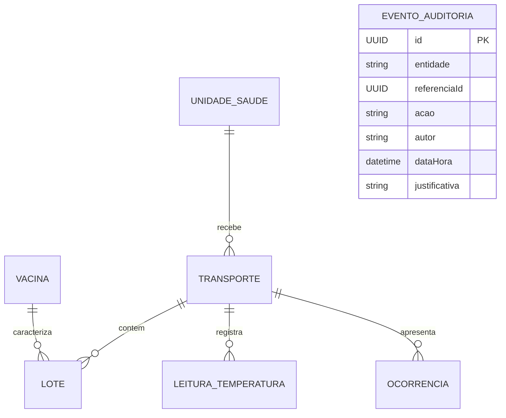

# VaciSmart — API Java

Estado da J4 em 12/11/2026: **J4 concluída e oficialmente aprovada pelo responsável**, após a validação operacional final no PostgreSQL. A J4 implementa autenticação JWT e autorização por perfil/unidade. As evidências de J1–J3 abaixo são históricas; a seção Segurança — J4 descreve o comportamento vigente e registra o fechamento da etapa.
Em 13/11/2026, a J5-A acrescenta o recebimento operacional descrito ao final deste documento, em revisão. As menções anteriores a recebimento pendente registram os marcos J1–J4. A J5 inteira permanece incompleta.

Protótipo acadêmico FIAP Global Solution 2026/2 (CitizenTech) de monitoramento térmico de lotes de vacinas em transporte simulado, bloqueio preventivo e informação de disponibilidade ao cidadão. Dados fictícios: não é sistema clínico nem autoriza aplicação real.

## Problema, beneficiário e ODS
O projeto demonstra como registrar ocorrências térmicas e apoiar a conferência humana. A informação de disponibilidade ao cidadão é objetivo do projeto, ainda não implementado na J4, sem reserva ou garantia de dose. Beneficiário final: cidadão; usuários operacionais: funcionário de unidade e gestor. ODS principal 3 (Saúde e Bem-Estar); secundários 9 e 10.

## Equipe
Nome da equipe: pendente de confirmação para o VaciSmart. Responsável por Java Advanced e DevOps: Giovanni; RM, turma e relação completa de integrantes ainda pendentes de confirmação.

| Nome | RM | Turma |
|---|---|---|
| A preencher | A preencher | A preencher |

## Pitch
Link: a preencher.
Demais links de entrega: pendentes de confirmação; nenhum endereço foi anunciado sem validação.

## Como executar
Pré-requisitos: JDK 21, Docker Engine e Docker Compose, porta 5432 disponível e acesso ao Maven Central no primeiro uso. O Maven Wrapper fixa Maven 3.9.11. Spring Boot 4.1.2 ([versão estável](https://spring.io/projects/spring-boot/), [compatibilidade Java](https://docs.spring.io/spring-boot/system-requirements.html)); decisões em DUVIDAS.md.

Configure JAVA_HOME para um **JDK completo** 21 (java e javac) e adicione `$JAVA_HOME/bin` ao PATH, somente na sessão atual. Exemplo (substitua o caminho pela sua instalação):
```bash
export JAVA_HOME=/caminho/do/jdk-21
export PATH="$JAVA_HOME/bin:$PATH"
```

Antes de iniciar a API, disponibilize o par RSA externo e exporte `JWT_CHAVE_PUBLICA` e `JWT_CHAVE_PRIVADA` na mesma sessão, conforme [Chaves e ambiente local](#chaves-e-ambiente-local). Sem as chaves, o startup falha. Os testes no perfil test geram seu próprio par efêmero.

Na raiz (copie o exemplo somente se ainda não houver .env local; preserve os valores existentes):
```bash
cp .env.example .env
# Revise .env: os valores fornecidos são exemplos exclusivos do desenvolvimento local.
docker compose -f compose.dev.yml up -d
docker compose -f compose.dev.yml ps
./mvnw test
# Exporte as mesmas variáveis para o Spring (Compose não as exporta para a API).
set -a
. ./.env
set +a
# As chaves JWT externas já devem estar disponíveis no ambiente desta sessão.
./mvnw spring-boot:run -Dspring-boot.run.profiles=dev
```
O arquivo .env deve conter somente atribuições de variáveis confiáveis; o comando acima o executa no shell. A API também aceita DB_URL, DB_USER e DB_PASSWORD já exportadas. Defaults de exemplo existem somente no perfil dev. Não há perfil padrão nem credenciais de produção. API operacional em http://127.0.0.1:8080/api/v1; A raiz não possui endpoint; sem token, a proteção padrão responde401. O servidor continua vinculado a 127.0.0.1 para demonstração local. Configure as chaves RSA externas antes do startup, conforme Segurança — J4. Endpoints operacionais exigem JWT.

O perfil dev usa PostgreSQL, Flyway e `ddl-auto=validate`. `V0__baseline.sql` contém somente comentário e foi preservada. `V1__modela_nucleo_termico.sql` cria as sete tabelas do núcleo, chaves estrangeiras, checks e índices; não há seed automático na J2. `V2__modela_usuarios.sql` acrescenta os usuários da J4; V0, V1 e V2 foram validadas no PostgreSQL 17.6 conforme o fechamento de 12/11/2026. O perfil test usa H2 em memória (modo PostgreSQL), sem Flyway e `create-drop`. Fuso America/Sao_Paulo e JSON com datas ISO-8601. Nunca usar as credenciais de exemplo fora do ambiente local.

O Compose de desenvolvimento publica o PostgreSQL somente em `127.0.0.1:5432`, mantendo a porta interna 5432 e a comunicação pela rede dos containers. A restrição vale ao criar/reconfigurar o serviço com o arquivo atualizado; containers existentes não foram recriados nesta consolidação. O Maven Wrapper mantém Maven 3.9.11 e sua URL original, agora com `distributionSha256Sum` conferido contra o ZIP validado pelo SHA-512 oficial do Maven Central; fonte e método registrados em DUVIDAS.md (D-047).

Para parar sem apagar o volume:
```bash
docker compose -f compose.dev.yml down
```

## Estrutura
`pom.xml` e Maven Wrapper na raiz; código em `src/main/java/br/com/fiap/vacismart`; pacotes config, domain (entity, enums, rules), repository, service, web (controller, dto, advice), security. Domínio, repositories, service e config implementam o núcleo J2; web contém Controllers, DTOs e Advice da J3. security contém configuração JWT, respostas 401/403 e autorização baseada nos vínculos persistidos. Especificação em [docs/ESPECIFICACAO.md](docs/ESPECIFICACAO.md); governança em [AGENTS.md](AGENTS.md); decisões em [DUVIDAS.md](DUVIDAS.md).

## Entidades e relacionamentos
A J2 modela UnidadeSaude, Vacina, Transporte, Lote, LeituraTemperatura, Ocorrencia e EventoAuditoria com UUID gerado pelo Hibernate. `Entidade` centraliza somente o identificador. Nomes de tabelas/colunas seguem snake_case. Os estados e a disponibilidade são enums persistidos como STRING.



Os vínculos são unidirecionais do lado N para 1. Auditoria identifica o objeto por entidade e referenciaId, sem FK polimórfica. Cada leitura guarda transporte, dispositivoId textual, temperaturaC, medidaEm, recebidaEm e classificação agregada; não há entidade Dispositivo nem integração com hardware.

`Vacina` guarda temperaturaMinC, temperaturaMaxC e margemAtencaoC. `Transporte.inicioMonitoramentoEm` é a referência para detectar silêncio antes da primeira leitura. Auditoria não tem setters, é marcada `@Immutable` e tem colunas não atualizáveis; o serviço somente insere eventos. Não há operação pública de alteração/exclusão de auditoria. A proteção contra SQL direto e políticas de retenção ficam para a infraestrutura futura.

### Regras implementadas na J2

- `MonitoramentoService.iniciarMonitoramento`: CADASTRADO → EM_TRANSPORTE, exige pelo menos um lote e registra auditoria SISTEMA. Ação de simulação, exposta localmente por POST /api/v1/transportes/{id}/monitoramento na J3, então sem autenticação; desde a J4 exige JWT e autorização por perfil/unidade.
- `registrarLeitura`: aceita somente EM_TRANSPORTE; valida dispositivo, decimal e medição entre o início do monitoramento e o recebimento. Persiste a leitura e classifica cada vacina usando BigDecimal.compareTo. Aceita medições atrasadas dentro desse intervalo; telemetria considera recebimento.
- Demo A: NORMAL de 3 a 7 inclusive, ATENCAO de 2 a menos de 3 ou acima de 7 até 8, FORA_DA_FAIXA abaixo de 2 ou acima de 8. A atenção fica registrada na classificação e não bloqueia.
- Faixas por vacina: min < max, margem >= 0 e 2 × margem <= max − min. Valores numeric(10,3), até sete dígitos inteiros e três decimais, são validados antes de persistir para impedir arredondamento que altere a classificação. Não se fixam faixas universais.
- Transporte misto: uma leitura do sensor representa o ambiente compartilhado. Cada lote é avaliado com os parâmetros da sua vacina. A classificação persistida da leitura é a mais grave encontrada; somente lotes cuja vacina estiver FORA_DA_FAIXA e cujo estado for EM_MONITORAMENTO são bloqueados. Auditoria identifica cada lote afetado. A classificação agregada não deve ser usada futuramente para decidir todos os lotes. Não se deduz a temperatura individual de cada embalagem.
- Desvio abre no máximo uma ocorrência ABERTA por tipo/transporte. Normalização não encerra a ocorrência térmica nem libera lotes; novos desvios não repetem o evento de bloqueio de lote já bloqueado. Nunca há descarte automático ou conclusão clínica.
- `encerrarOcorrencia`: encerra uma aberta com justificativa e auditoria SISTEMA, sem mudar lote ou disponibilidade. É operação interna, sem decisão técnica nem autenticação no marco J2; na J4 o serviço verifica acesso ao transporte. Não há endpoint de encerramento.
- `verificarPerdaTelemetria`: método explícito, sem agendador. Mais de três minutos desde o último recebimento (ou início sem leituras) abre PERDA_DE_TELEMETRIA. Exatamente três minutos não abre. Parâmetro `vacismart.telemetria.limite` aceita duração ISO-8601 positiva, padrão `PT3M`. O retorno booleano informa se uma ocorrência nova foi criada. Telemetria sozinha não bloqueia lotes. Retomada de leitura válida encerra somente essa ocorrência e audita; não libera lote nem confirma disponibilidade.
- Todas as operações do serviço são transacionais. Lock pessimista na linha de Transporte serializa início, leituras, encerramento e verificação. Índice único parcial no PostgreSQL reforça a unicidade de ocorrências abertas. Testes H2 verificam também concorrência e rollback.

Recebimento, decisões técnicas, aplicação, confirmação de disponibilidade e transições posteriores continuam pendentes. Enums desses estados estão modelados; não há métodos para executá-los nesta J2.

## Usuários de teste por papel

O provisionamento opcional da J4 cria cidadão, funcionário A, funcionário B e gestor fictícios. E-mails e senhas são fornecidos localmente, sem valores padrão no código. Veja Segurança — J4. O dispositivo terá credencial própria em etapa futura; não é um quarto perfil humano.

## Endpoints
A J3 implementa os endpoints operacionais locais detalhados adiante, com prefixo /api/v1. Disponibilidade ao cidadão e decisão continuam pendentes; recebimento foi acrescentado na J5-A; cadastro/login e própria conta estão na seção J4.

Contrato completo para o colega e o Gemini: [Integração Mobile/Gemini — J4](docs/INTEGRACAO_MOBILE_GEMINI.md), com os 29 pares método/rota da J4 e o adendo de recebimento J5-A, DTOs, validações e exemplos conferidos no código. Documento reconstruído a partir do backend; não substitui por inferência o contrato original da equipe. D-002 continua aberta até o alinhamento bilateral e a validação real com o aplicativo.

## Justificativas: consultas, cascade e fetch
Todos os `@ManyToOne` são LAZY e obrigatórios, evitando carregar a cadeia inteira em consultas simples. Não há cascade: unidades, vacinas, transportes, lotes, leituras e ocorrências têm ciclos próprios; salvar/remover um filho não deve salvar/remover seus pais nem apagar histórico. Repositories salvam as referências explicitamente. A consulta de lotes usa `@EntityGraph(attributePaths = "vacina")` porque a classificação precisa dos parâmetros de todas as vacinas, evitando N+1 nesse fluxo. Open-in-view permanece desabilitado.

Sete interfaces estendem JpaRepository. As consultas derivadas do núcleo J2 atendem lotes por transporte, leituras por transporte/último recebimento, ocorrências por transporte/tipo/estado e auditoria por referência. Uma JPQL com `PESSIMISTIC_WRITE` busca o transporte por UUID para serializar as regras. A J3 acrescenta consultas paginadas, JPQL de ocorrências e Specifications de lotes/transportes, detalhadas adiante. Entidades não são contratos HTTP; records específicos definem entradas e saídas.

## Testes
Execute `./mvnw -B test` com JDK 21 completo. A suíte contém teste de contexto, testes isolados do classificador e integração do serviço/repositories com `@SpringBootTest`, perfil test e H2. Os testes controlam `Clock`, sem Thread.sleep, e cobrem limites, parâmetros inválidos, transporte misto, persistência, auditoria, bloqueio seletivo, ausência de liberação/descarte automático, duplicidade sequencial/concorrente, rollback e perda de telemetria.

T01–T03 e T09 têm cobertura de domínio nesta J2. No marco J2, T04–T08/T10 dependiam de etapas posteriores; T06/T10 têm cobertura HTTP de segurança na J4. H2 usa create-drop com Flyway desabilitado: não valida V1, o índice parcial ou compatibilidade integral com PostgreSQL. As evidências históricas de J1–J4 e a validação PostgreSQL de 12/11/2026 aparecem separadas abaixo.

## Limitações e escopo
J1 entregou bootstrap; J2 acrescentou domínio, persistência e regras térmicas; J3 acrescenta REST, validação, paginação e filtros; J4 acrescenta Security/JWT e provisionamento opt-in exclusivo de dev. OpenAPI continua para J5. Compose final API + banco e implantação Azure ficam com DevOps.
Por decisão definitiva do responsável em 12/11/2026, **Spring Cache, Spring HATEOAS e Spring Boot Actuator não serão implementados** e não integram J5/J6/J7; o planejamento histórico D-007 foi superado por D-046. OpenAPI/Swagger permanece previsto. Continuam fora do MVP: GPS/rastreamento de veículos, rotas/localização de transporte, agendamento/reserva, notificações externas (push/e-mail/SMS), integração SUS/RNDS, QR Code, mapa de surtos, IA e funcionalidades clínicas reais. A especificação da API prevalece sobre os materiais de referência; caderneta digital e disponibilidade informativa ao cidadão não estão implementadas.

## Declaração de uso de IA
Codex foi usado na J1 para estrutura/configuração/documentação e, na J2, para consultar o blogBackend, implementar domínio, regras, testes e documentação e executar as validações relatadas abaixo. Na J3 foi usado para implementar e testar a API REST, consultas e documentação. Na J4 foi usado para implementar autenticação/autorização, testes, documentação e relatório local. Em 12/11/2026, após a validação operacional final e a revisão externa dos relatórios pelo ChatGPT, o responsável aprovou oficialmente a conclusão da J4. A atualização documental pré-push também utilizou Codex, sem implementação nova. Claude: ferramenta indicada pelo solicitante; não houve uso de Claude verificável nas execuções relatadas. A equipe deve complementar apenas com seu uso real, sem atribuir revisões ou atividades não comprovadas.

## Status por funcionalidade
| Funcionalidade | Status |
|---|---|
| Bootstrap Maven/Java 21, perfis e pacotes | Criado |
| PostgreSQL 17.6 / Flyway V0, V1 e V2 | Validação operacional local aprovada em 12/11/2026; limites na seção J4 |
| Governança e especificação | Criadas |
| Contexto no perfil test | Validação abaixo |
| Entidades, repositories, regras térmicas e auditoria (J2) | Implementados; evidências abaixo |
| Seed automático | Não implementado na J2; dados fictícios nas fixtures de testes |
| CRUD HTTP e consultas avançadas (J3) | Implementados; regressões abaixo |
| Segurança (J4) | Concluída e aprovada pelo responsável em 12/11/2026 |
| Recebimento de transporte (J5-A) | Implementado; em revisão |
| OpenAPI (J5) | Pendente |
| Compose final / Azure | Pendente — DevOps |

## Evidências históricas de execução da J1
Em 06/11/2026:
- Maven Wrapper gerado pelo plugin oficial 3.3.4, tipo only-script, fixando Maven 3.9.11.
- A instalação `/usr/lib/jvm/java-21-openjdk-amd64` continha runtime 21, mas não javac; primeira tentativa de teste falhou com `release version 21 not supported` ao recorrer ao compilador 17.
- Usado Eclipse Temurin 21.0.13+9 em instalação temporária, baixado pela API oficial Adoptium, com SHA-256 verificado. JAVA_HOME/PATH foram selecionados apenas para a execução; nenhum Java instalado, JAVA_HOME global ou configuração de sistema foi alterado. A instalação temporária não é pré-requisito permanente.
- Antes dos testes: `java -version` = Temurin 21.0.13; `javac -version` = 21.0.13; `./mvnw -version` = Maven 3.9.11 com runtime Temurin 21.0.13.
- `./mvnw -B test`, com JAVA_HOME/PATH do JDK acima selecionados para a execução: **BUILD SUCCESS**, 1 teste, 0 falhas, 0 erros e 0 ignorados; contexto no perfil test com H2. Houve avisos não fatais de processamento de anotações e de autoanexação do agente Mockito/Byte Buddy no Java 21.
- `docker compose -f compose.dev.yml config --quiet`: passou.
- `docker compose -f compose.dev.yml up -d --wait`: falhou; daemon Docker indisponível (`/var/run/docker.sock` ausente no ambiente com execução autorizada). CLI Docker 29.9.0 e Compose v5.5.1 estão presentes. PostgreSQL e migration V0 **não validados em execução**.
- `./mvnw spring-boot:run -Dspring-boot.run.profiles=dev`: não executado por falta do PostgreSQL. Após disponibilizar o daemon, repetir os passos de execução acima.
- `git diff --check`: passou; `.env` e `target` são ignorados; especificação conferida por igualdade integral com o pedido.

Relatório Surefire local: `target/surefire-reports/`. Os logs temporários de validação não são versionados.

## Referência didática da J2

Consultado [blogBackend](https://github.com/opatriarcha/2026_fiap_2tdspa_java_advanced/tree/2f3f5aaba185267023f4aace702fd2a4c6be81cf/blogBackend), commit `2f3f5aaba185267023f4aace702fd2a4c6be81cf`, como referência didática. Exemplos lidos: Post, Comment, Order, CommentRepository, CommentService, AbstractCrudService, CommentServiceTest, CustomRepositoriesIntegrationTest e pom.xml. Foram aproveitados os conceitos de UUID, mapeamentos, Bean Validation, JpaRepository, injeção por construtor, transações em serviços e separação de testes isolados/integração. As classes foram criadas para o domínio VaciSmart.

Diferenças: mantemos Boot 4.1.2 e a estrutura de pacotes existente; o exemplo usa 4.1.0 e CRUD genérico. Aqui o serviço coordena regras específicas, usa BigDecimal para temperaturas, referências LAZY sem cascade e auditoria por evento. Post usa ManyToOne sem fetch explícito; Comment explicita LAZY e usa remoção por cascade no banco, que não se aplica ao nosso histórico. Order demonstra CascadeType.ALL, não adotado. QueryDSL, JWT e JaCoCo do exemplo não foram adicionados.

## Evidências históricas da J2 — 08/11/2026

JDK temporário Temurin 21.0.13, Maven Wrapper 3.9.11, Boot 4.1.2, perfil test/H2. Nenhuma versão ou perfil alterado. Com JAVA_HOME/PATH desse JDK selecionados para a execução, cada rodada independente usou:

```bash
./mvnw -B test
```

| Rodada | Testes | Falhas | Erros | Ignorados | Resultado | Duração Maven | Conclusão (America/Sao_Paulo) |
|---|---|---|---|---|---|---|---|
| 1 | 45 | 0 | 0 | 0 | BUILD SUCCESS | 14.871 s | 2026-11-08T00:56:43-03:00 |
| 2 | 45 | 0 | 0 | 0 | BUILD SUCCESS | 11.321 s | 2026-11-08T00:59:35-03:00 |
| 3 | 45 | 0 | 0 | 0 | BUILD SUCCESS | 11.353 s | 2026-11-08T00:59:47-03:00 |

Execução preliminar anterior ao ajuste de normalização decimal: BUILD SUCCESS, 43 testes, zero falhas/erros/ignorados. As três rodadas acima incluem o código final e os casos adicionais de `5.2000`. Relatórios Surefire em `target/surefire-reports/`, não versionados. Avisos não fatais: processamento de anotações e agente Mockito/Byte Buddy no Java 21.

`git diff --check` passou. Especificação, pom, application.yml e V0 comparados com 7e60863: sem alterações. PostgreSQL, aplicação das migrations V0+V1, checks/índice parcial e startup dev continuam não testados operacionalmente; não foi alterado banco real, Azure ou produção. A J2 está pronta para revisão do domínio com essa pendência explícita.

## API REST operacional — J3

**Registro histórico da J3, anterior à segurança. A J4 exige JWT e aplica a matriz de permissões abaixo.** Bind padrão 127.0.0.1. Nenhuma configuração de CORS irrestrito. Na J3 os papéis da especificação ainda não estavam protegidos; não há API pública de dados internos. Não publicar, criar proxy/túnel ou implantar na Azure nesta etapa.

Arquitetura: Controller recebe/valida → Service transacional aplica regras e mapeia DTOs → Repository consulta/persiste. Os Controllers não classificam temperatura. `OperacaoTransporteController` chama diretamente `MonitoramentoService.registrarLeitura`; a entidade retornada é convertida em `LeituraSaidaDto`, nunca serializada. Demais consultas mapeiam dentro da transação, com open-in-view desabilitado. Relacionamentos seguem LAZY/sem cascade; DTOs usam somente os IDs dos vínculos, sem carregar nomes de pais. O EntityGraph da J2 continua atendendo a classificação térmica.

Todas as rotas abaixo recebem o prefixo `/api/v1`. Todos os IDs são UUID. GET nunca altera estado. POST de criação retorna 201, corpo e Location relativo resolvível; PUT retorna 200 e corpo; DELETE permitido e início de monitoramento retornam 204 sem corpo.

| Método | Rota | Entrada ou consulta | Regra / saída |
|---|---|---|---|
| POST | /unidades | nome | Cria unidade; UnidadeSaidaDto |
| GET | /unidades | page, size, sort | Página de unidades |
| GET | /unidades/{id} | — | UnidadeSaidaDto |
| PUT | /unidades/{id} | nome | Atualiza nome |
| DELETE | /unidades/{id} | — | Somente sem transportes/histórico |
| POST | /vacinas | nome, temperaturaMinC, temperaturaMaxC, margemAtencaoC | Cria vacina; VacinaSaidaDto |
| GET | /vacinas | page, size, sort | Página de vacinas |
| GET | /vacinas/{id} | — | VacinaSaidaDto |
| PUT | /vacinas/{id} | mesmos campos de criação | Faixa só muda se não existirem lotes; nome pode mudar |
| DELETE | /vacinas/{id} | — | Somente sem lotes/histórico |
| POST | /transportes | codigo, unidadeSaudeId | Estado inicial CADASTRADO |
| GET | /transportes | unidadeId, estado, page, size, sort | Página com filtros combináveis |
| GET | /transportes/{id} | — | TransporteSaidaDto |
| PUT | /transportes/{id} | codigo, unidadeSaudeId | Somente CADASTRADO |
| DELETE | /transportes/{id} | — | Somente CADASTRADO sem lotes/leituras/ocorrências/histórico |
| POST | /transportes/{id}/monitoramento | Sem corpo | Regra da J2: exige lotes, muda para EM_TRANSPORTE e audita |
| POST | /lotes | codigo, vacinaId, transporteId | Transporte CADASTRADO; EM_MONITORAMENTO/NAO_DISPONIVEL |
| GET | /lotes | transporteId, vacinaId, estado, page, size, sort | Página com filtros combináveis |
| GET | /lotes/{id} | — | LoteSaidaDto |
| PUT | /lotes/{id} | codigo | Somente EM_MONITORAMENTO com transporte CADASTRADO; vínculos imutáveis |
| GET | /lotes/{id}/historico | page, size, sort | Auditoria somente do lote identificado |
| POST | /transportes/{id}/leituras | transporteId, dispositivoId, temperaturaC, medidaEm | transporteId obrigatório e igual à rota; regra térmica J2 |
| GET | /transportes/{id}/leituras | page, size, sort | Página de leituras do transporte |
| GET | /transportes/{id}/leituras/{leituraId} | — | Leitura somente se pertencer ao transporte |
| GET | /transportes/{id}/ocorrencias | estado, page, size, sort | Página de ocorrências; JPQL |
| GET | /transportes/{id}/historico | page, size, sort | Auditoria somente da entidade Transporte; eventos dos lotes são consultados nos respectivos lotes |

No marco histórico J3, não havia endpoints de login/cidadão; cadastro público de cidadão, login e própria conta foram acrescentados na J4, conforme a seção de segurança. Permanecem ausentes DELETE de lotes, CRUD de auditoria, escrita pública em ocorrências, recebimento, decisão técnica, disponibilidade, aplicação de doses, liberação ou descarte. Verificação de perda de telemetria e encerramento de ocorrências continuam métodos internos, sem endpoint/agendador.

### Validações e preservação do histórico

Entradas e saídas são records diferentes. Campos desconhecidos no JSON são rejeitados com 400, incluindo `estado`, `disponibilidade`, `autor`, `id` e classificações calculadas quando não pertencem ao DTO de entrada. `@NotBlank`/`@Size` limitam nome a 150, código a 60 e dispositivoId a 100 caracteres. `@NotNull` exige referências e dados de leitura. `@DecimalMin`/`@DecimalMax` delimitam numeric(10,3); `Validacoes.decimal` preserva a validação exata da J2 sem arredondar (aceita 5.2000, rejeita 8.0001). `Validacoes.faixa` exige min < max, margem >= 0 e 2 × margem <= max − min. A margem deve ser informada explicitamente (demo: 1).

A prioridade da classificação é explícita: NORMAL=0, ATENCAO=10, FORA_DA_FAIXA=20. `maisGraveQue` usa esse valor, sem ordinal e sem alterar parâmetros térmicos. A comparação continua estrita: classificações iguais não substituem a atual.

Faixas de vacinas com lotes ficam congeladas, inclusive antes do início, para impedir reinterpretação de avaliações existentes. Renomear a vacina é permitido com parâmetros numericamente iguais. Lote só permite corrigir código antes do monitoramento; vacina/transporte não podem ser trocados. Cadastro de novos lotes após o início retorna 409. Código de lote/transporte é único; colisão retorna 409. Atualizações cadastrais não mudam estados; transições existentes continuam auditadas pela J2, com autor SISTEMA na simulação.

Locks pessimistas de unidade e vacina serializam exclusão/alteração com criação de referências; operações de lote/transporte usam o lock do transporte já adotado no monitoramento. FKs/uniqueness permanecem como proteção adicional. SQL direto e concorrência no PostgreSQL real não são comprovados pelos testes H2. Criar/editar/excluir referências é responsabilidade do Service, sem cascade de remoção.

### Paginação, ordenação e filtros

Todas as listagens usam `Pageable` e paginação no banco; nenhuma carrega tudo para paginar em memória. `page` inicia em 0; padrão `size=20`, máximo 100 (valores maiores são limitados a 100). O resolver padrão Spring Data normaliza page negativo/inválido para 0 e size inválido/não positivo para o padrão. `sort=campo,asc` ou `sort=campo,desc`, repetível. Sem sort, ordena por id; id também desempata outras ordenações. Não implica ordem cronológica: use os campos de data quando necessário. Campo fora da lista abaixo retorna 400.

| Recurso | Campos permitidos em sort |
|---|---|
| unidades, vacinas | id, nome |
| transportes | id, codigo, estado, inicioMonitoramentoEm |
| lotes | id, codigo, estado |
| leituras | id, medidaEm, recebidaEm, temperaturaC, classificacao |
| ocorrências | id, abertaEm, encerradaEm, tipo, estado |
| histórico | id, dataHora, acao |

Exemplo: `GET /api/v1/lotes?transporteId={uuid}&vacinaId={uuid}&estado=EM_MONITORAMENTO&page=0&size=10&sort=codigo,asc`. Filtros opcionais combinam com AND; ausência de resultados autorizados retorna página vazia. Na J4, transporteId em filtros de lotes também verifica acesso ao transporte: funcionário recebe 403 para pai alheio/inexistente e gestor recebe 404 para inexistente; filtros de unidade alheia são negados. Não garantir página vazia para todo UUID sem correspondência. Consulta de recurso ou filho inexistente sob pai autorizado retorna 404, respeitada a proteção por perfil/unidade descrita na J4.

Formato próprio, estável, sem metadados internos do PageImpl:
```json
{"conteudo":[{"id":"11111111-1111-1111-1111-111111111111","nome":"Unidade Demonstrativa 01"}],"pagina":0,"tamanho":20,"totalElementos":1,"totalPaginas":1}
```

### Consultas JPA justificadas

- Derivadas: `findByTransporteId(UUID, Pageable)` lista leituras de um transporte; `findByEntidadeAndReferenciaId` consulta auditoria do recurso; `existsByVacinaId` e `existsByUnidadeSaudeId` protegem dependências sem carregar coleções.
- JPQL: `OcorrenciaRepository.consultarPorTransporte` filtra por transporte e, opcionalmente, estado. Permite inspeção operacional de abertas/encerradas com a mesma consulta paginada e contagem no banco. JPQL usa parâmetros e não concatena entradas do usuário. A JPQL de lock da J2 permanece.
```java
@Query("select o from Ocorrencia o where o.transporte.id = :transporteId "
        + "and (:estado is null or o.estado = :estado)")
Page<Ocorrencia> consultarPorTransporte(UUID transporteId, EstadoOcorrencia estado, Pageable pageable);
```
- `Specification`: `Filtros.lotes` combina transporteId, vacinaId e estado; `Filtros.transportes` combina unidadeId e estado. Evita a multiplicação de métodos para cada combinação e aplica filtros/ordenação/paginação no SQL. Nenhum QueryDSL acrescentado.

### Exemplos HTTP locais

Os UUIDs e horários abaixo são ilustrativos. Substitua pelos IDs retornados pelos cadastros. Cadastre unidade → vacina → transporte → lote; inicie monitoramento; só então envie leitura com medidaEm entre o início retornado pelo GET do transporte e o instante atual, sempre com offset.

```http
POST /api/v1/unidades
Content-Type: application/json

{"nome":"Unidade Demonstrativa 01"}
```
```http
HTTP/1.1 201 Created
Location: /api/v1/unidades/11111111-1111-1111-1111-111111111111

{"id":"11111111-1111-1111-1111-111111111111","nome":"Unidade Demonstrativa 01"}
```
```http
POST /api/v1/vacinas
Content-Type: application/json

{"nome":"Vacina Demo A","temperaturaMinC":2.0,"temperaturaMaxC":8.0,"margemAtencaoC":1.0}

POST /api/v1/transportes
Content-Type: application/json

{"codigo":"TRP-001","unidadeSaudeId":"11111111-1111-1111-1111-111111111111"}

POST /api/v1/lotes
Content-Type: application/json

{"codigo":"VAC-2026-001","vacinaId":"22222222-2222-2222-2222-222222222222","transporteId":"33333333-3333-3333-3333-333333333333"}

POST /api/v1/transportes/33333333-3333-3333-3333-333333333333/monitoramento
```
Resposta do início: `204 No Content`. A leitura mantém o campo transporteId do exemplo da especificação, conferido contra a rota:
```http
POST /api/v1/transportes/33333333-3333-3333-3333-333333333333/leituras
Content-Type: application/json

{"transporteId":"33333333-3333-3333-3333-333333333333","dispositivoId":"ARDUINO-DEMO-01","temperaturaC":9.3,"medidaEm":"2026-11-10T14:20:30-03:00"}
```
```http
HTTP/1.1 201 Created
Location: /api/v1/transportes/33333333-3333-3333-3333-333333333333/leituras/44444444-4444-4444-4444-444444444444

{"id":"44444444-4444-4444-4444-444444444444","transporteId":"33333333-3333-3333-3333-333333333333","dispositivoId":"ARDUINO-DEMO-01","temperaturaC":9.3,"medidaEm":"2026-11-10T14:20:30-03:00","recebidaEm":"2026-11-10T14:20:31-03:00","classificacao":"FORA_DA_FAIXA"}
```
Os offsets de saída podem ser normalizados pelo serializador para o mesmo instante; não depender da representação textual exata do offset. A consulta posterior do lote afetado devolve BLOQUEADO_PREVENTIVAMENTE e NAO_DISPONIVEL. 5.2 classifica NORMAL e 7.5 ATENCAO; nenhuma libera/descarta. No transporte misto só bloqueia os lotes fora da faixa da respectiva vacina. Normalização não encerra ocorrência térmica nem libera lote.

### Respostas de erro

`ErroApiAdvice` estende ResponseEntityExceptionHandler e usa `application/problem+json` (`ProblemDetail`). 400: Bean Validation, JSON/campo desconhecido, UUID/enum/data inválidos, faixa/precisão inválida ou transporteId divergente da rota. 404: recurso/referência inexistente. 409: estado incompatível, duplicidade, dependências ou concorrência. 405: método HTTP não permitido. 500: resposta genérica segura, sem stack trace ou detalhes de persistência. Erros MVC como 415 preservam seu código adequado. No marco J3 não havia 401/403 funcional; a J4 acrescentou esses códigos e o escopo por unidade, detalhados na matriz e nos erros de segurança vigentes.

```json
{"type":"about:blank","title":"Conflict","status":409,"detail":"Lote já possui monitoramento","instance":"/api/v1/lotes/55555555-5555-5555-5555-555555555555"}
```
Validação de DTO acrescenta `campos`, por exemplo `[{"campo":"nome","mensagem":"não deve estar em branco"}]` (mensagem depende do idioma do Validator). Erro inesperado usa `detail="Erro interno ao processar a requisição"`.

### Testes e limites da J3

Testes HTTP usam `@SpringBootTest(RANDOM_PORT)`, JDK HttpClient, Jackson 3, Clock fixo e H2 separado (`vacismart-http`), passando por Controller → Service → Repository real, sem mocks de domínio. Não exigem nova dependência de testes. O controlador de falha inesperada existe somente em src/test e não entra no JAR.

Total final: 89 testes (45 da J2 preservados + 12 de prioridade explícita + 32 HTTP). Cobrem criação/Location/consulta, DTO inválido, UUID/enum/datas inválidos, 404, atualizações permitidas/proibidas, faixa congelada, rollback, duplicidade, paginação/ordenação/limite, Specifications, JPQL, 5.2/7.5/9.3, bloqueio/auditoria, normalização sem liberação/descarte, transporte misto, exclusão protegida, GET sem transição e histórico somente leitura, além de 500 seguro. Primeiro teste após a correção: 57/0/0/0; implementação inicial com HTTP: 86/0/0/0; preliminar final: 89/0/0/0. Todos BUILD SUCCESS.

PostgreSQL real, Flyway V0/V1, checks/índice parcial e startup dev continuam pendentes de validação operacional. Os testes H2 usam create-drop/Flyway desabilitado e não comprovam esses itens. Não houve acesso a banco real, deploy, push ou avanço à J4.

### Regressões finais independentes da J3 — 08/11/2026

Cada rodada iniciou novo processo Maven/JVM com o código final, com JAVA_HOME/PATH do JDK 21 selecionados para a execução:
```bash
./mvnw -B test
```

| Rodada | Testes | Falhas | Erros | Ignorados | Resultado | Duração Maven | Conclusão (America/Sao_Paulo) |
|---|---|---|---|---|---|---|---|
| 1 | 89 | 0 | 0 | 0 | BUILD SUCCESS | 17.187 s | 2026-11-08T22:47:57-03:00 |
| 2 | 89 | 0 | 0 | 0 | BUILD SUCCESS | 16.076 s | 2026-11-08T22:48:15-03:00 |
| 3 | 89 | 0 | 0 | 0 | BUILD SUCCESS | 16.016 s | 2026-11-08T22:48:33-03:00 |

Compilação e empacotamento: `./mvnw -B -DskipTests package`, com o mesmo JDK 21, BUILD SUCCESS; testes omitidos somente nesse comando após as três regressões completas. Artefato local: `target/vacismart-java-api-0.0.1-SNAPSHOT.jar`. Relatórios Surefire em `target/surefire-reports/`, não versionados. Avisos não fatais de annotation processing e Mockito/Byte Buddy persistem.

## Correção de mapeamento JPA/PostgreSQL — 09/11/2026

A execução real em dev revelou `missing column [temperaturac]` em leitura_temperatura. A configuração do projeto não substitui a nomenclatura padrão do Boot4.1.2: estratégia física `org.hibernate.boot.model.naming.PhysicalNamingStrategySnakeCaseImpl` e implícita `org.springframework.boot.hibernate.SpringImplicitNamingStrategy`, confirmadas nas propriedades efetivas do Hibernate. A estratégia física não insere underscore antes da maiúscula final isolada `C`: os quatro campos abaixo divergiam da V1.

| Entidade / atributo Java | Nome físico inferido antes | Coluna da V1 / mapeamento corrigido |
|---|---|---|
| LeituraTemperatura.temperaturaC | temperaturac | temperatura_c |
| Vacina.temperaturaMinC | temperatura_minc | temperatura_min_c |
| Vacina.temperaturaMaxC | temperatura_maxc | temperatura_max_c |
| Vacina.margemAtencaoC | margem_atencaoc | margem_atencao_c |

Correção mínima: quatro `@Column(name = ...)` em LeituraTemperatura e Vacina, preservando precisão/escala/nullability, atributos Java, JSON, regras e estratégia global. As outras cinco entidades, os IDs herdados de Entidade e todos os JoinColumn já correspondiam à V1. Nenhuma migration, dependência, contrato HTTP ou configuração de perfil foi alterada. dev continua `ddl-auto=validate`.

Por que H2 não detectou antes: o perfil test usa create-drop; o Hibernate criava as colunas com os mesmos nomes inferidos que usava nas consultas. O novo `MapeamentoSchemaTest` compara os nomes físicos efetivos de todas as sete entidades (38 colunas, incluindo IDs/FKs) com os CREATE TABLE do recurso V1. Antes da correção: 7 testes, 2 falhas (vacina/leitura), 0 erros/ignorados. Depois: suíte completa com **96 testes, 0 falhas, 0 erros, 0 ignorados, BUILD SUCCESS**, 22.018s, conclusão 2026-11-09T00:01:01-03:00. Os 89 testes anteriores permanecem inalterados. O teste compara nomes; não executa SQL PostgreSQL, não valida índices/checks nem substitui startup real.

Validação operacional atual: container existente postgres:17.6 saudável; consulta PostgreSQL confirmou versão17.6 e V0/V1 com success=true. Inicialização real com perfil dev e porta local livre (41293): Flyway `Successfully validated 2 migrations`, schema public na versão1 e `No migration necessary`; Hibernate `Initialized JPA EntityManagerFactory`; aplicação `Started VaciSmartApplication in 5.558 seconds` às 2026-11-09T00:03:16-03:00. O processo temporário foi encerrado após o startup. Banco/volume/container foram preservados; nenhuma migration foi reaplicada. Isto valida o startup/esquema existente, não todos os fluxos funcionais ou concorrência em PostgreSQL. As pendências anteriores de startup/validação de esquema acima são evidências históricas, superadas por esta execução; testes funcionais PostgreSQL, checks/índice parcial sob carga e segurança continuam fora desta correção.

A falha de regressão anterior à correção, descrita acima, era esperada e não representa falha no código final.

Para repetir no Ubuntu com o PostgreSQL existente, use JDK21 completo no JAVA_HOME/PATH, o .env local já configurado (não o sobrescreva) e as chaves JWT externas exportadas antes do startup, conforme [Chaves e ambiente local](#chaves-e-ambiente-local). A partir de um diretório do clone VaciSmart confirmado, identifique sua raiz pelo Git:
```bash
cd "$(git rev-parse --show-toplevel)"
java -version
javac -version
./mvnw -B test
docker compose -f compose.dev.yml ps
set -a
. ./.env
set +a
./mvnw spring-boot:run -Dspring-boot.run.profiles=dev
```
Na versão atual, configure também as chaves JWT descritas abaixo. O .env deve conter atribuições confiáveis: o comando acima o executa no shell. Aguarde as mensagens de validação Flyway, `Initialized JPA EntityManagerFactory` e `Started VaciSmartApplication`, sem `Schema validation: missing column`. Caso a porta8080 já esteja em uso, acrescente `-Dspring-boot.run.arguments=--server.port=8081` ao último comando. Em outro terminal, `curl -i -H "Authorization: Bearer $JWT_ACESSO" "http://127.0.0.1:8080/api/v1/unidades?page=0"` deve retornar200 com a página para funcionário/gestor autenticado (JWT_ACESSO é obtido no login); sem token, retorna401 (ajuste a porta, se necessário). Ctrl+C encerra somente a API. Não é necessário apagar banco/volume, alterar migrations ou usar ddl-auto=update/create. API continua somente local; sem push ou deploy.


## Segurança — J4

### Arquitetura e persistência

`AuthController → AutenticacaoService → UsuarioRepository` cadastra somente CIDADAO e autentica com BCrypt (custo12). `Usuario` contém UUID, nome, e-mail normalizado em minúsculas/único, hash, perfil, unidade opcional e ativo. FUNCIONARIO exige unidade; os demais perfis não têm vínculo. `V2__modela_usuarios.sql` cria tabela, FK, índice e checks; V0/V1 permanecem intactas. Não há CRUD público de usuários, perfis ou vínculos.

Spring Security Resource Server valida assinatura RS256, emissor, expiração e claims obrigatórias; NimbusJwtEncoder oficial emite tokens. Claims: `sub` (UUID), `perfil`, `iss`, `iat`, `exp`. Validade padrão15 minutos, configurável entre um valor positivo e uma hora (`JWT_VALIDADE`, ISO-8601), sem tolerância adicional na expiração. Não há refresh token. API stateless, sem HTTP Basic, login por formulário ou sessão. CSRF desabilitado porque a credencial é Bearer explícita no cabeçalho, sem autenticação automática por cookie.

A cada requisição, o usuário ativo e o perfil são consultados no banco. Os serviços também consultam a identidade persistida e aplicam o escopo da unidade; `perfil` no token é informativo. Desativação, mudança de perfil ou troca de vínculo valem na próxima requisição, inclusive com token anterior. Não se promete interromper uma operação que já estava em execução. Chaves privadas e senhas nunca são respostas HTTP; DTOs de autenticação omitem dados em `toString`.

### Matriz de permissões vigente

| Operação | CIDADAO | FUNCIONARIO | GESTOR |
|---|---|---|---|
| POST /auth/cadastro e /auth/login | Públicas | Públicas | Públicas |
| GET /auth/me | Própria conta | Própria conta | Própria conta |
| GET /unidades e /unidades/{id} | Negado | Somente própria unidade | Todas |
| POST, PUT, DELETE /unidades | Negado | Negado | Permitido conforme vínculos |
| GET /vacinas e /vacinas/{id} | Negado | Permitido | Permitido |
| POST, PUT, DELETE /vacinas | Negado | Negado | Permitido conforme regras |
| GET, POST, PUT, DELETE /transportes e consulta por ID | Negado | Somente própria unidade | Todas conforme regras |
| GET /lotes, /lotes/{id}; PUT /lotes/{id} | Negado | Somente própria unidade | Todas conforme regras |
| POST /lotes | Negado | Negado | Permitido, como exige a especificação |
| POST /transportes/{id}/monitoramento | Negado | Somente própria unidade | Todas conforme regras |
| GET/POST /transportes/{id}/leituras, GET de leitura por ID | Negado | Somente própria unidade, simulação local | Todas, simulação local |
| GET de ocorrências e históricos operacionais existentes | Negado | Somente própria unidade | Todas |
| Alterar auditoria, liberar/descartar, recebimento e decisão técnica | Não implementado | Não implementado | Não implementado |

Todas as rotas usam `/api/v1`. Somente os dois POSTs exatos de cadastro/login são públicos; demais métodos e caminhos exigem autenticação. Rotas novas ficam protegidas por padrão. Cidadão não recebe catálogo operacional, transporte, lote, leitura, dispositivo, ocorrência ou auditoria. A consulta de disponibilidade e a caderneta não fazem parte desta etapa.

Funcionário não pode transferir transporte para outra unidade. Cadastros/edições/exclusões respeitam estados, dependências e histórico da J3. O escopo das listagens de unidades, transportes e lotes é aplicado na consulta SQL antes da paginação, incluindo contagem e filtros. Históricos, ocorrências e leituras verificam o transporte/lote pai. Após obter o lock do transporte, a entidade é recarregada com EntityManager.refresh sob PESSIMISTIC_WRITE e a unidade é conferida novamente. Isso evita autorizar com a unidade antiga mantida no cache JPA antes de uma transferência concorrente. O gestor mantém as mesmas restrições térmicas; normalização nunca libera lote, não há descarte automático e auditoria continua imutável. Eventos automáticos de monitoramento preservam o autor SISTEMA da J2; os fluxos humanos de recebimento/decisão com autoria individual permanecem futuros.

Erros: 401 para credenciais inválidas, usuário inativo/inexistente, ausência de Bearer ou JWT inválido/expirado; `WWW-Authenticate: Bearer`. 403 para perfil/escopo negado. Para funcionário, UUID de transporte/lote inexistente e UUID de outra unidade produzem a mesma resposta403, sem revelar existência. Gestor recebe404 para recurso inexistente; leitura inexistente sob transporte autorizado também404. Erros continuam em `application/problem+json` com campos `type`, `title`, `status`, `detail`; 400/404/405/409/500 da J3 são preservados. CORS rejeitado pelo filtro pode responder403 sem corpo ProblemDetail.

### Chaves e ambiente local

Não há chave padrão, segredo embutido ou geração automática em dev. Sem os arquivos, a aplicação falha no startup. Use OpenSSL localmente para gerar um par **exclusivo da demonstração**, fora do Git:

```bash
umask 077
mkdir -p "$HOME/.config/vacismart-dev"
openssl genpkey -algorithm RSA -pkeyopt rsa_keygen_bits:3072 -out "$HOME/.config/vacismart-dev/privada.pem"
openssl pkey -in "$HOME/.config/vacismart-dev/privada.pem" -pubout -out "$HOME/.config/vacismart-dev/publica.pem"
export JWT_CHAVE_PRIVADA="file:$HOME/.config/vacismart-dev/privada.pem"
export JWT_CHAVE_PUBLICA="file:$HOME/.config/vacismart-dev/publica.pem"
export JWT_EMISSOR=vacismart
export JWT_VALIDADE=PT15M
export CORS_ORIGENS=http://localhost:5173
```

A chave privada usa PEM PKCS#8, pública X.509; o par deve corresponder e ter ao menos2048 bits. Não gerar novas chaves a cada reinício se quiser preservar tokens até a expiração. Rotação por substituição coordenada invalida tokens assinados pela chave anterior; múltiplas chaves/JWKS e revogação individual não estão implementados. Proteger arquivos, ambiente e transporte TLS na futura infraestrutura; não reutilizar as chaves de demonstração. O perfil test recebe par efêmero gerado exclusivamente em `src/test`, sem chaves fixas no repositório.

CORS: `CORS_ORIGENS` aceita lista separada por vírgulas de origens exatas (`http(s)://host:porta`), sem caminho, wildcard ou credenciais. Vazio desabilita origens de navegador. Métodos GET/POST/PUT/DELETE/OPTIONS, cabeçalhos Authorization/Content-Type e resposta Location são autorizados para as origens configuradas. Não habilita cookies. Preflight permitido não fornece acesso aos dados; a requisição real exige JWT. Clientes Flutter nativos e Arduino não dependem de CORS para proteção: continuam precisando de autenticação.

### Provisionamento fictício opcional

O bootstrap é desabilitado por padrão. Exige **somente o perfil dev**, `VACISMART_DEMO_HABILITADO=true` e `VACISMART_DEMO_CONFIRMACAO=DADOS_FICTICIOS_LOCAIS`; não é ativado com prod/test e rejeita qualquer perfil adicional. Forneça os quatro pares de credenciais; não há senha padrão:

```bash
export DEMO_CIDADAO_EMAIL=cidadao@demo.invalid
export DEMO_FUNCIONARIO_A_EMAIL=funcionario.a@demo.invalid
export DEMO_FUNCIONARIO_B_EMAIL=funcionario.b@demo.invalid
export DEMO_GESTOR_EMAIL=gestor@demo.invalid
for papel in CIDADAO FUNCIONARIO_A FUNCIONARIO_B GESTOR; do
  read -r -s -p "Senha fictícia para $papel: " "DEMO_${papel}_SENHA"
  echo
  export "DEMO_${papel}_SENHA"
done
export VACISMART_DEMO_HABILITADO=true
export VACISMART_DEMO_CONFIRMACAO=DADOS_FICTICIOS_LOCAIS
./mvnw spring-boot:run -Dspring-boot.run.profiles=dev
```

Configure também banco/JDK/chaves antes desse comando. O bootstrap cria duas unidades fictícias A/B e quatro usuários numa transação, codifica senhas e não registra credenciais. Exige e-mails novos e válidos; se alguma conta já existir, falha sem sobrescrevê-la. Depois da primeira execução, retire `VACISMART_DEMO_HABILITADO`, a confirmação e as variáveis de credenciais do ambiente (ou abra uma sessão limpa e reconfigure apenas banco/JWT). Não repetir o bootstrap para alterar usuários. Os testes automatizados comprovam as condições do runner. A execução real, pendente em 10/11, foi validada no PostgreSQL 17.6 em 12/11/2026: quatro usuários e duas unidades novos, com bootstrap desabilitado no reinício utilizado para os testes e dados preexistentes preservados.

### Cadastro, login e uso do Bearer

Cadastro público aceita exclusivamente `nome`, `email`, `senha`; `perfil`, `unidadeSaudeId`, `ativo` e outros campos desconhecidos retornam400. Nome até150 caracteres; e-mail válido até254, normalizado; senha de12 a72 caracteres ASCII imprimíveis (evita ultrapassar72 bytes do BCrypt). Senha não é normalizada nem removida de espaços. E-mail duplicado retorna409, inclusive com caixa diferente. As strings entre `<...>` abaixo são marcadores para dados fictícios escolhidos localmente, não credenciais prontas:

```http
POST /api/v1/auth/cadastro
Content-Type: application/json

{"nome":"Cidadão fictício","email":"novo@demo.invalid","senha":"<senha-ficticia-local>"}
```

Resposta201: `{id,nome,email,perfil:"CIDADAO",unidadeSaudeId:null}`, com Location `/api/v1/auth/me` (consulta exige login). Login:

```http
POST /api/v1/auth/login
Content-Type: application/json

{"email":"novo@demo.invalid","senha":"<senha-ficticia-local>"}
```

Resposta200: `{token,tipo:"Bearer",expiraEm,usuario:{id,nome,email,perfil,unidadeSaudeId}}`. Guarde o token apenas no cliente local e envie em todas as operações autenticadas, incluindo os exemplos operacionais da J3 acima:

```http
GET /api/v1/auth/me
Authorization: Bearer <token-retornado-no-login>

GET /api/v1/transportes?page=0&size=20
Authorization: Bearer <token-de-funcionario-ou-gestor>
```

O segundo exemplo é negado ao cidadão. Não incluir tokens reais em arquivos versionados, logs ou capturas de apresentação. As credenciais pessoais do funcionário não serão usadas pelo Arduino. A ingestão atual é exclusivamente a simulação autenticada: autenticação própria de dispositivos continua pendente e nenhuma rota pública de leitura foi criada.

### Validação e limites atuais

Execute com JDK21 completo: `./mvnw -B test`; para empacotar após as regressões: `./mvnw -B -DskipTests package`. Os testes existentes foram preservados: HTTP J3 agora autentica um gestor fictício; os testes de regras térmicas isolam somente a autorização com Mockito, mantendo regras, persistência, concorrência, locks, rollback e auditoria reais. Novos testes HTTP de segurança exercitam o Resource Server, login e serviços/repositories reais com cidadão, gestor e funcionários A/B; verificam revogação por estado/vínculo, JWTs inválidos, paginação/contagem, filtros, IDs e fluxo térmico autorizado. MapeamentoSchemaTest também compara a entidade Usuario com V2, sem substituir PostgreSQL real.

Registro histórico de 10/11/2026: PostgreSQL não esteve acessível por ausência dos sockets default/desktop-linux; naquela execução não foram testados V2/startup dev, checks/FKs ou provisionamento real, e a evidência de 09/11 cobria apenas V0/V1. As pendências de acesso, validação de V0–V2 no esquema existente, startup, provisionamento e fluxo térmico do escopo J4 foram resolvidas na validação operacional de 12/11 descrita abaixo. Isso não comprova aplicação inédita de V2, todos os checks/FKs sob cenários adversos, carga/concorrência PostgreSQL, produção, hardware ou implantação.

Não foram adicionados Swagger/OpenAPI, integração Arduino, Flutter, Azure, recebimento, decisão técnica, disponibilidade ou doses; J5/J6/J7 e DevOps não estão concluídos. Os recursos excluídos definitivamente constam em Limitações e escopo. Proteção contra abuso de login/cadastro, recuperação de senha, revogação individual e rotação com múltiplas chaves são limitações futuras; não foram inventados fluxos adicionais nesta J4.


### Regressões finais independentes da J4 — 10/11/2026

Temurin21.0.13+9 (JDK temporário com SHA-256 oficial conferido), Maven Wrapper3.9.11, Boot4.1.2/Security7.1.2 e H2. Cada rodada executou um processo Maven/JVM independente com o código final, recompilando a partir de `clean`, com JAVA_HOME/PATH desse JDK selecionados para a execução:

```bash
./mvnw -B clean test
```

| Rodada | Testes | Falhas | Erros | Ignorados | Resultado | Duração Maven | Conclusão (America/Sao_Paulo) |
|---|---|---|---|---|---|---|---|
| 1 | 180 | 0 | 0 | 0 | BUILD SUCCESS | 58.924 s | 2026-11-10T13:16:18.650746-03:00 |
| 2 | 180 | 0 | 0 | 0 | BUILD SUCCESS | 59.176 s | 2026-11-10T13:17:19.354027-03:00 |
| 3 | 180 | 0 | 0 | 0 | BUILD SUCCESS | 59.327 s | 2026-11-10T13:18:20.170805-03:00 |

Total180 =96 casos anteriores preservados +1 novo caso de mapeamento Usuario/V2 +74 casos de integração de segurança (HTTP e serviços) +9 casos de entidade/provisionamento. Empacotamento posterior com Java21: `./mvnw -B -DskipTests package`, BUILD SUCCESS, 2.549 s, concluído 2026-11-10T13:18:24-03:00. Artefato: `target/vacismart-java-api-0.0.1-SNAPSHOT.jar`. Nenhuma alteração de código entre as três regressões e o empacotamento.

Relatórios Surefire em `target/surefire-reports/`, não versionados. Avisos não fatais de annotation processing e autoanexação Mockito/Byte Buddy permanecem. Desenvolvimento preliminar: compilação inicialmente corrigiu import ambíguo de RSAKey; primeira suíte163/0/1/0 corrigiu asserção que tentava converter o emissor textual em URL; suíte ajustada175/0/0/0. Antes da revisão final também passaram três rodadas com179 testes. O reforço com refresh sob lock e o teste de transferência concorrente foram adicionados depois; essas rodadas anteriores não validam essa última correção. Teste concorrente isolado:1/0/0/0, BUILD SUCCESS (15.526s). Somente as três rodadas com180 testes acima representam o código final.

Em 10/11/2026, migration V2 no PostgreSQL, startup dev e bootstrap real permaneceram NÃO TESTADOS por indisponibilidade dos sockets Docker. Essa limitação histórica foi superada no escopo operacional registrado a seguir. O relatório A–L permanece exclusivamente local em `RELATORIO_REVISAO_CHATGPT.md`, ignorado e fora do Git. O aceite da J4 não autoriza publicação nem avanço automático de etapa.

### Encerramento e validação operacional da J4 — 12/11/2026

**J4 oficialmente concluída e aprovada pelo responsável.** Ambiente validado: Java 21, Spring Boot 4.1.2 e PostgreSQL 17.6, com Flyway V0/V1/V2 já aplicadas e bem-sucedidas. Os dois startups da validação final conferiram as três migrations, sem necessidade de nova aplicação, e o Hibernate validou o esquema com `ddl-auto=validate`.

| Evidência anterior a esta edição documental | Resultado e limite |
|---|---|
| Suíte automatizada em 12/11, às 00:03:56 | **180 testes aprovados, 0 falhas, 0 erros, 0 ignorados; BUILD SUCCESS**, 57.854 s; perfil test/H2. As três regressões de 10/11 permanecem registradas acima. |
| Repetição na auditoria preventiva de 12/11 | **180/0/0/0; BUILD SUCCESS**, 56.235 s; execução isolada do mesmo código, JDK 21/Maven 3.9.11 offline e H2. |
| Validação operacional final no PostgreSQL 17.6 | **109 verificações aprovadas, 0 falhas no escopo solicitado**; verificações HTTP, claims/assinatura, estado, persistência e integridade, não 109 testes JUnit. |

O cadastro público de cidadão já havia sido validado na etapa anterior de 12/11 e não foi repetido no bloco das 109 verificações. Na validação final, o provisionamento opt-in criou quatro contas demonstrativas — cidadão, funcionários A/B e gestor — representando os três perfis CIDADAO, FUNCIONARIO e GESTOR. Login, JWT RS256 e própria conta foram validados nas quatro contas; senhas com BCrypt, endpoints operacionais protegidos e isolamento entre unidades nos dois sentidos foram conferidos.

O fluxo térmico completo **do escopo J4** percorreu normal → atenção → fora da faixa → normal, com quatro leituras persistidas, ocorrência térmica aberta, bloqueio preventivo, auditoria/histórico e nenhuma liberação ou descarte automático. Consultas JPQL de ocorrências com estado ausente, ABERTA e ENCERRADA, contagem e paginação foram aprovadas para funcionário autorizado e gestor. Os três registros preexistentes (dois usuários e uma unidade) permaneceram integralmente preservados. O bootstrap foi desabilitado no reinício dos testes e as duas instâncias temporárias da API foram encerradas.

Esses resultados são registros das validações anteriores, não testes executados nesta atualização documental. H2 não comprova PostgreSQL; validação local não comprova produção, carga/concorrência PostgreSQL, hardware ou integração Mobile. Recebimento, decisão técnica, liberação, disponibilidade informativa e caderneta digital continuam sem implementação; OpenAPI/Swagger permanece previsto. O documento externo `VaciSmart_Integracao_Mobile_Gemini_J4_2026-11-10.md`, informado pelo responsável, não foi localizado no workspace. A versão [interna para Mobile/Gemini](docs/INTEGRACAO_MOBILE_GEMINI.md) foi reconstruída a partir do código atual; não comprova equivalência ao `02_MODELO_E_CONTRATOS.md` ausente nem encerra o alinhamento bilateral. Nenhum contrato HTTP foi modificado.


## Recebimento operacional — J5-A — 13/11/2026

`POST /api/v1/transportes/{id}/recebimento`, sem corpo JSON, exige Bearer JWT válido. FUNCIONARIO atua somente na unidade de destino; GESTOR tem o escopo global do MVP. CIDADAO e funcionário de outra unidade recebem 403. Sucesso: 204 sem corpo. Transporte inexistente segue J4: 403 para funcionário e 404 para gestor; estado diferente de EM_TRANSPORTE, inclusive repetição, retorna 409. Ausência de autenticação ou JWT inválido retorna 401.

O transporte passa a RECEBIDO; somente lotes EM_MONITORAMENTO passam a AGUARDANDO_CONFERENCIA. BLOQUEADO_PREVENTIVAMENTE e demais estados são preservados. Não há liberação, descarte, confirmação de disponibilidade, encerramento automático de ocorrência ou finalização. Eventos imutáveis RECEBIDO (Transporte) e AGUARDANDO_CONFERENCIA (cada Lote efetivamente alterado) registram UUID do autor autenticado e o mesmo instante do Clock do backend. Não há campos de entrada para identidade, perfil, unidade ou horário.

FluxoOperacionalService coordena uma transação única. Reutiliza o lock pessimista, refresh e revalidação da unidade de MonitoramentoService; a regra de telemetria foi compartilhada minimamente no mesmo pacote. Antes da transição, verifica silêncio maior que o limite configurado desde a última recepção/início. Se necessário, abre PERDA_DE_TELEMETRIA uma única vez com auditoria SISTEMA, sem bloquear ou liberar lotes. Ocorrências existentes permanecem abertas. Nenhuma tabela, coluna, migration, dependência ou configuração de segurança foi alterada.

Testes novos reaproveitam fixtures HTTP/JWT e integração transacional existentes. Os resultados atuais estão no relatório privado A–L e são distintos das evidências históricas acima. H2 não comprova comportamento de locks/índices no PostgreSQL. J5-B/J5-C/J5-D, J6 e DevOps não foram executados. Codex foi usado na implementação, testes e documentação da J5-A; a entrega aguarda revisão externa.
