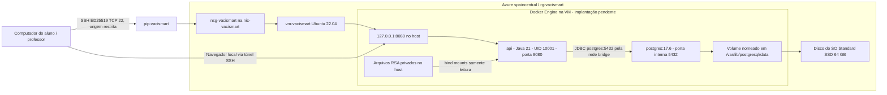

# VaciSmart — DevOps Tools & Cloud Computing

**Global Solution FIAP 2026/2 — CitizenTech.** Documentação técnica, How To de reprodução e roteiro para apresentação presencial. Estado registrado em **18/11/2026**.

> **Leia primeiro:** a execução local D1/D2 foi validada e aprovada. A VM Azure e a instalação do Docker foram informadas como concluídas pelo responsável; **a implantação da API/PostgreSQL e os testes na VM ainda estão pendentes**. Os procedimentos de nuvem abaixo são instruções para execução futura, não evidências de deploy já realizado. Nesta tarefa documental nenhum comando Azure, SSH ou Docker foi executado.

## Identificação e equipe

| Integrante | RM |
|---|---|
| Giovanni Sacristan | 567548 |
| Gabriel Deotti Zanatta | 567258 |
| Murilo Massini | 567383 |
| Caike Roberto de Souza Hollo | 568104 |
| Gianluca Kenis de Araujo | 566765 |

**Turma:** 1TDSPA, anteriormente informada, **pendente de confirmação final**; os documentos atuais do repositório não a confirmam. Giovanni foi indicado para Java Advanced e DevOps; não foram atribuídas responsabilidades individuais aos demais integrantes.

Repositório identificado no Git local: [Vacismart-java-api](https://github.com/gi13090/Vacismart-java-api). A disponibilidade pública da versão final deve ser conferida antes da entrega; os arquivos desta preparação ainda dependem de staging, commits e publicação autorizados. Vídeo e PDF final: pendentes.

## Sumário

- [Estado real e pendências](#estado-real-e-pendências)
- [Arquitetura e configurações](#arquitetura-e-configurações)
- [Reprodução da infraestrutura](#reprodução-da-infraestrutura)
- [Roteiro de apresentação ao professor](#roteiro-de-apresentação-ao-professor)
- [Evidências e entrega](#evidências-e-entrega)
- [Cobertura da rubrica oficial](#cobertura-da-rubrica-oficial)
- [Referências e declaração acadêmica](#referências-e-declaração-acadêmica)

## Estado real e pendências

| Etapa | Situação confirmada | O que falta |
|---|---|---|
| D1 — infraestrutura local | Dockerfile multi-stage Java 21; Compose API/PostgreSQL 17.6; build; JDBC; Flyway; RSA externo; usuário não-root | Nenhuma pendência técnica no recorte local aprovado |
| D2 — demonstração local | JWT RS256; POST/GET/PUT/DELETE; SELECT; JOIN; persistência após stop/start; dados anteriores preservados | Repetir a demonstração na Azure, sem tratar a evidência local como evidência de nuvem |
| D3 — Azure | Azure for Students; recursos abaixo; provisionamento por CLI e SSH por ED25519, conforme informação do responsável | Conferir estado/configuração e registrar evidências para a entrega |
| D4 — host da VM | SSH funcional; Docker Engine 29.10.0, Compose v5.8.0, serviço active e hello-world, conforme informação do responsável | Implantar API e PostgreSQL; validar JWT, CRUD, SQL, JOIN e persistência na VM |
| Entregáveis | How To e script preparados para revisão | Diagrama final validado, prints, vídeo, PDF, turma e links finais |

Infraestrutura Azure informada:

| Item | Configuração |
|---|---|
| Assinatura | Azure for Students; ID não publicado |
| Grupo / região | `rg-vacismart` / `spaincentral` |
| VM / tamanho | `vm-vacismart` / `Standard_D2s_v4` |
| Sistema observado | Ubuntu 22.04.5 LTS |
| NIC / IP público | `nic-vacismart` / `pip-vacismart` |
| VNet / sub-rede | `vnet-vacismart` / `subnet-vacismart` |
| NSG | `nsg-vacismart`, SSH TCP/22 limitado ao IPv4 público do operador |
| Autenticação SSH | Chave pública ED25519; chave privada fica no computador do operador |
| Disco do SO | Standard SSD (`StandardSSD_LRS`), 64 GB |

CIDRs, nome/prioridade da regra SSH, usuário administrativo e valores de IP/assinatura não foram fornecidos para publicação. Devem ser descobertos no ambiente existente ou informados explicitamente ao reproduzir. O script **não presume esses valores**. Para uma VM nova, `Ubuntu2204` seleciona a família 22.04 disponível; não promete reproduzir exatamente o patch histórico 22.04.5.

## Arquitetura e configurações

O VaciSmart é um protótipo acadêmico de monitoramento térmico de lotes de vacinas em transporte simulado. Registra ocorrências, bloqueios preventivos, decisões humanas e disponibilidade informativa ao cidadão. Usa dados fictícios; não é um sistema clínico nem autoriza administração real de vacina. Regras e contratos estão em [ESPECIFICACAO.md](docs/ESPECIFICACAO.md) e no [README da API](README.md).

### Responsabilidades

- **Azure:** hospeda VM, NIC, IP público, VNet, sub-rede, NSG e disco gerenciado.
- **VM Ubuntu:** fornece o sistema operacional e o disco onde o Docker mantém os dados. Não utiliza Docker Desktop.
- **Docker Engine:** executa os containers, a rede bridge e o volume local ao host.
- **Docker Compose:** define e coordena `api` e `postgres`, ambiente, mounts e dependência de saúde.
- **API Spring Boot:** autentica por JWT RS256, aplica autorização e regras de negócio; usa JDBC/JPA e Flyway.
- **PostgreSQL:** mantém o modelo relacional em volume nomeado. `lote` referencia `vacina` e `transporte`; `transporte` referencia `unidade_saude`.

### Prévia técnica da arquitetura a validar na VM

O esquema abaixo corresponde à topologia configurada nos arquivos. **A parte de containers dentro da VM ainda precisa ser implantada e validada; este esquema não substitui o diagrama final de entrega.** Não há AKS, banco gerenciado, balanceador ou API pública anunciados.



O volume Docker fica no disco da VM; não é um banco gerenciado nem um backup. Parar containers preserva o volume. Apagar o disco/VM com seus dados pode perder o banco; essa operação não integra o roteiro.

### Dockerfile real

[Dockerfile](Dockerfile): build em `eclipse-temurin:21-jdk-jammy`, `WORKDIR /build`, Wrapper **3.3.4** executando Maven **3.9.11**, comando `package` com testes omitidos no build. Não usa Maven clean. `unzip` é instalado somente no build, com `--no-install-recommends`, e as listas APT são removidas. Isso mantém o download ZIP compatível com o SHA-256 fixado; o checksum e o Wrapper não são desabilitados/modificados.

O runtime usa `eclipse-temurin:21-jre-jammy`, `WORKDIR /app`, usuário/grupo `10001:10001`, `/app/app.jar` e `ENTRYPOINT java -jar`. `EXPOSE 8080` descreve a porta interna; a publicação é feita pelo Compose. As `ENV` definem perfil `dev`, endereço interno `0.0.0.0`, porta 8080, fuso e caminhos `file:/run/keys/*.pem`. Credenciais, chaves e dados do banco não entram na imagem. [.dockerignore](.dockerignore) restringe o contexto a insumos de build e exclui ambiente, chaves, Git, target e relatórios.

### Compose real e variáveis

[docker-compose.yml](docker-compose.yml) contém os serviços `api` e `postgres`, rede bridge explícita `vacismart` e volume `postgres_data`. O Compose prefixa rede, volume e containers pelo projeto; descobrir os nomes reais por inspeção evita inventar identificadores.

| Configuração | Significado |
|---|---|
| `DB_NAME`, `DB_USER`, `DB_PASSWORD` | Obrigatórios, fornecidos externamente; nunca publicar valores reais |
| `DB_URL` da API no Compose | Calculado como `jdbc:postgresql://postgres:5432/${DB_NAME}`; não usa localhost para falar com o banco |
| `API_PORT` | Porta do host, padrão 8080; publicação somente em `127.0.0.1` |
| `DOCKER_JWT_PUBLIC_KEY`, `DOCKER_JWT_PRIVATE_KEY` | Caminhos absolutos no host; não são URIs `file:` |
| `JWT_CHAVE_PUBLICA`, `JWT_CHAVE_PRIVADA` | Caminhos internos fixados no Compose como Resources `file:/run/keys/...` |
| `JWT_EMISSOR`, `JWT_VALIDADE`, `CORS_ORIGENS` | Opcionais; defaults existentes, sem CORS irrestrito |
| Perfil `dev` | PostgreSQL, Flyway V0/V1/V2 e Hibernate `validate`; Swagger disponível para a demonstração restrita |

O healthcheck executa `pg_isready`; `api` depende de `postgres` com `service_healthy`. Isso aguarda o banco aceitar conexões, mas não substitui a validação HTTP do startup da API. A API não possui healthcheck próprio nem Actuator neste escopo.

As chaves JWT são um par RSA de pelo menos 2048 bits, pública X.509 e privada PKCS#8. São diferentes da chave ED25519 de SSH. Bind mounts são somente leitura e `create_host_path: false` impede criar diretórios quando o arquivo não existe.

### Firewall e acesso

O NSG libera somente o SSH necessário à origem autorizada; não se criam regras de entrada pública para 8080 ou 5432. A API é publicada em loopback da VM e acessada por túnel SSH. O banco tem porta **interna** 5432 e não possui `ports` no host. Assim, sua porta está configurada e disponível à API, sem exposição pública. Não depender apenas de UFW: publicação de portas Docker pode interagir com regras de firewall; preservar o bind loopback e o NSG restrito.

## Reprodução da infraestrutura

**Procedimento futuro:** não foi executado nesta preparação. D3 e a instalação D4 já informadas não devem ser refeitas durante a apresentação. Reutilize os recursos existentes; não rode provisionamento apenas para obter prints.

### Ambientes e convenções

- **[LOCAL UBUNTU]:** computador do aluno, chave privada SSH e navegador.
- **[AZURE CLI]:** Azure Cloud Shell em Bash ou Azure CLI no Ubuntu local; controla recursos Azure.
- **[VM]:** terminal aberto por SSH no Ubuntu da VM; Docker Engine e Compose, sem Docker Desktop.
- **[PSQL]:** cliente dentro do container PostgreSQL; comandos SQL e metacomandos `\...`.

Variáveis de uma sessão não são transferidas automaticamente para outra. Repita as definições indicadas em cada terminal. Não use `set -x`, não exiba arquivos de credenciais, `docker inspect` completo ou `compose config` sem `--quiet` em capturas.

### 1. Pré-requisitos: Azure CLI, assinatura e código

**[AZURE CLI]** Ter Azure CLI autenticada (`az login` no Ubuntu; Cloud Shell usa a sessão do portal), assinatura Azure for Students ativa, permissões/quota e disponibilidade de `Standard_D2s_v4` em `spaincentral`. Falha de quota/região exige revisão, não troca automática de região/tamanho. Python 3 e cliente OpenSSH são usados pelo script para validar entradas.

```bash
az version
az account list --query "[].{Assinatura:name,Estado:state}" --output table
read -r -p 'ID da assinatura autorizada, sem gravá-lo no README: ' SUBSCRIPTION_ID
RG=rg-vacismart
LOCATION=spaincentral
VM_NAME=vm-vacismart
az account show --subscription "$SUBSCRIPTION_ID" --query '{Assinatura:name,Estado:state}' --output table
```

O ID é fornecido pelo operador, não inventado neste documento. O script usa `--subscription` em todas as consultas/comandos sem mudar a assinatura global do CLI.

O clone público só conterá estes arquivos **depois da publicação Git autorizada**. Em uma cópia pública disponível ao professor:

```bash
# [LOCAL UBUNTU ou CLOUD SHELL] Preparar cópia para ler/executar futuramente o script.
git clone --branch master --single-branch https://github.com/gi13090/Vacismart-java-api.git
cd Vacismart-java-api
git ls-files --error-unmatch Dockerfile docker-compose.yml README_DEVOPS.md scripts/azure/provisionar-vm.sh
```

Se faltarem arquivos, interrompa e confirme a publicação da versão correta. Não adaptar o Java para contornar uma cópia desatualizada.

### 2. Chave SSH segura

**[LOCAL UBUNTU]** Escolher um caminho dedicado. Se a chave já existir, reutilizar o par correto; nunca sobrescrevê-lo. O comando abaixo gera ED25519 apenas quando nenhum dos dois arquivos existe e permite configurar passphrase interativamente.

```bash
SSH_KEY="$HOME/.ssh/vacismart_ed25519"
install -d -m 700 "$HOME/.ssh"
if [ -e "$SSH_KEY" ] || [ -e "$SSH_KEY.pub" ]; then
  test -f "$SSH_KEY" && test -f "$SSH_KEY.pub" || {
    printf 'Par incompleto: preserve os arquivos e revise antes de continuar.\n'
    false
  }
else
  ssh-keygen -t ed25519 -a 100 -f "$SSH_KEY" -C vacismart
fi
chmod 600 "$SSH_KEY"
chmod 644 "$SSH_KEY.pub"
ssh-keygen -lf "$SSH_KEY.pub"
```

Confirme sucesso de cada comando. A chave privada nunca vai para Git, Cloud Shell ou VM. Se provisionar pelo Cloud Shell, envie **apenas** o `.pub` e use o caminho desse arquivo em `SSH_PUBLIC_KEY` naquela sessão. Verifique a fingerprint do servidor em canal confiável no primeiro SSH; não desative a verificação de host.

### 3–9. Grupo, NSG, rede, SSH, IP, NIC e VM

O arquivo [scripts/azure/provisionar-vm.sh](scripts/azure/provisionar-vm.sh) implementa a sequência abaixo por Azure CLI. A execução padrão apenas valida entradas e imprime plano local. `--apply` requer confirmação digitada; antes da primeira criação ele inspeciona todos os recursos já existentes. Erros de rede/permissão não são tratados como ausência. Recursos incompatíveis geram interrupção, sem sobrescrita, exclusão ou rollback destrutivo.

| Passo | Comando implementado no script | Parâmetros relevantes |
|---|---|---|
| 3. Grupo | `az group create` somente se ausente | rg-vacismart, spaincentral |
| 4. NSG | `az network nsg create` somente se ausente | nsg-vacismart |
| 5. VNet/sub-rede | `az network vnet create` e `az network vnet subnet create` somente se ausentes | CIDRs privados informados explicitamente; sub-rede contida na VNet |
| 6. SSH restrito | `az network nsg rule create` somente se a regra não existir | TCP/22, origem pública individual /32, nome/prioridade explícitos |
| 7. IP | `az network public-ip create` somente se ausente | pip-vacismart; para reprodução nova: Standard, Static, IPv4 |
| 8. NIC | `az network nic create` somente se ausente | nic-vacismart ligada à sub-rede, NSG e IP |
| 9. VM | `az vm create` somente se ausente | NIC existente; Ubuntu2204; Standard_D2s_v4; SSD 64 GB; autenticação SSH |

Não há `--generate-ssh-keys`, criação de Docker Desktop ou abertura de portas da aplicação/banco. As características Standard/Static do IP são escolhas explícitas do script para reprodução; os metadados do IP existente devem ser conferidos, sem presumir o que não foi informado. O script também verifica chave/admin/NIC/disco da VM existente e aborta se divergirem.

**[AZURE CLI]** Para conhecer parâmetros do ambiente atual, use consultas de leitura; não registre origem residencial ou IDs de assinatura em prints públicos:

```bash
az network vnet show --subscription "$SUBSCRIPTION_ID" -g "$RG" -n vnet-vacismart \
  --query addressSpace.addressPrefixes --output tsv
az network vnet subnet show --subscription "$SUBSCRIPTION_ID" -g "$RG" \
  --vnet-name vnet-vacismart -n subnet-vacismart --query addressPrefix --output tsv
az network nsg rule list --subscription "$SUBSCRIPTION_ID" -g "$RG" --nsg-name nsg-vacismart \
  --query "[?direction=='Inbound'].{Regra:name,Prioridade:priority,Acesso:access,Protocolo:protocol,Porta:destinationPortRange}" -o table
az vm show --subscription "$SUBSCRIPTION_ID" -g "$RG" -n "$VM_NAME" --query osProfile.adminUsername -o tsv
```

Para uma reprodução futura autorizada, informar todos os valores, sem embutir IP residencial no código:

```bash
# [AZURE CLI] Use o usuário/chave/CIDRs reais existentes ou escolhas explícitas para um ambiente novo.
read -r -p 'Usuário administrativo da VM: ' ADMIN_USER
read -r -p 'Caminho do arquivo público ED25519 .pub: ' SSH_PUBLIC_KEY
read -r -p 'IPv4 público autorizado, com /32 (não publicar): ' SSH_SOURCE_CIDR
read -r -p 'Nome da regra SSH: ' SSH_RULE_NAME
read -r -p 'Prioridade da regra SSH (100 a 4096): ' SSH_PRIORITY
read -r -p 'CIDR privado da VNet: ' VNET_CIDR
read -r -p 'CIDR privado da sub-rede: ' SUBNET_CIDR

# Validação sintática e plano local: sem criar recursos.
bash -n scripts/azure/provisionar-vm.sh
bash scripts/azure/provisionar-vm.sh \
  --subscription "$SUBSCRIPTION_ID" --admin-user "$ADMIN_USER" --ssh-public-key "$SSH_PUBLIC_KEY" \
  --ssh-source-cidr "$SSH_SOURCE_CIDR" --ssh-rule-name "$SSH_RULE_NAME" --ssh-priority "$SSH_PRIORITY" \
  --vnet-cidr "$VNET_CIDR" --subnet-cidr "$SUBNET_CIDR"

# SOMENTE após autorização para provisionar; exige digitar PROVISIONAR rg-vacismart.
bash scripts/azure/provisionar-vm.sh \
  --subscription "$SUBSCRIPTION_ID" --admin-user "$ADMIN_USER" --ssh-public-key "$SSH_PUBLIC_KEY" \
  --ssh-source-cidr "$SSH_SOURCE_CIDR" --ssh-rule-name "$SSH_RULE_NAME" --ssh-priority "$SSH_PRIORITY" \
  --vnet-cidr "$VNET_CIDR" --subnet-cidr "$SUBNET_CIDR" --apply
```

Não filmar a entrada de dados privados. Se um recurso divergir, o script não o corrige automaticamente; revisar o ambiente e os parâmetros. Uma falha durante criação pode deixar recursos parciais: preservá-los e diagnosticar, sem executar exclusões automáticas.

A origem SSH deve ser o IPv4 público do computador que fará a conexão, não o IP de saída do Cloud Shell. Se o IP do operador mudar, revisar a regra por um procedimento autorizado; este script não amplia nem substitui silenciosamente a origem de uma regra existente.

### 10. Acesso SSH e túnel

**[LOCAL UBUNTU com Azure CLI autenticada]** Repetir `SUBSCRIPTION_ID`, `RG`, `VM_NAME` e `SSH_KEY` naquela sessão. Descobrir usuário e IP sem fixá-los no README:

```bash
RG=rg-vacismart
VM_NAME=vm-vacismart
SSH_KEY="$HOME/.ssh/vacismart_ed25519"
ADMIN_USER=$(az vm show --subscription "$SUBSCRIPTION_ID" -g "$RG" -n "$VM_NAME" --query osProfile.adminUsername -o tsv)
PUBLIC_IP=$(az network public-ip show --subscription "$SUBSCRIPTION_ID" -g "$RG" -n pip-vacismart --query ipAddress -o tsv)
test -n "$ADMIN_USER" && test -n "$PUBLIC_IP"
ssh -i "$SSH_KEY" "$ADMIN_USER@$PUBLIC_IP"
```

Se usar Cloud Shell para obter os metadados, transfira apenas os valores necessários à sessão local; mantenha a chave privada local. O túnel será aberto em outro terminal local depois que a API estiver implantada. Não criar regra NSG para 8080.

### 11. Docker Engine e Compose dentro da VM

**[VM]** A instalação foi informada como concluída; nesse caso apenas conferir versões/serviço. A instalação abaixo é para host novo e segue o repositório oficial do Docker. Se já houver instalação/repos configurados, não sobrescrever: conferir a configuração existente.

```bash
# [VM] Conferência em host já preparado.
cat /etc/os-release
sudo docker version
sudo docker compose version
systemctl is-active docker
```

Para preparar o deploy em uma VM que já tem Docker, conferir/instalar apenas os auxiliares necessários; isso não reinstala o Engine nem remove dados:

```bash
# [VM] Preparação de ferramentas para clone, RSA/ACL, HTTP e scripts de demonstração.
sudo apt-get update
sudo apt-get install -y git openssl acl python3 curl
```

Instalação futura em Ubuntu 22.04 novo, sem pacotes Docker conflitantes:

```bash
# [VM NOVA] Não executar novamente em host já configurado apenas para mostrar evidência.
sudo apt-get update
sudo apt-get install -y ca-certificates curl git openssl acl python3
sudo install -m 0755 -d /etc/apt/keyrings
test ! -e /etc/apt/keyrings/docker.asc && \
  sudo curl -fsSL https://download.docker.com/linux/ubuntu/gpg -o /etc/apt/keyrings/docker.asc
sudo chmod a+r /etc/apt/keyrings/docker.asc
# Somente se /etc/apt/sources.list.d/docker.sources ainda não existir:
if [ ! -e /etc/apt/sources.list.d/docker.sources ]; then
  sudo tee /etc/apt/sources.list.d/docker.sources >/dev/null <<EOF
Types: deb
URIs: https://download.docker.com/linux/ubuntu
Suites: $(. /etc/os-release && printf '%s' "$VERSION_CODENAME")
Components: stable
Architectures: $(dpkg --print-architecture)
Signed-By: /etc/apt/keyrings/docker.asc
EOF
fi
sudo apt-get update
sudo apt-get install -y docker-ce docker-ce-cli containerd.io docker-buildx-plugin docker-compose-plugin
sudo systemctl enable --now docker
sudo docker version
sudo docker compose version
sudo docker run hello-world
```

O repositório instala versões disponíveis no momento; **29.10.0/v5.8.0 são versões observadas e informadas**, não uma promessa de versão futura instalada. Para fixar versões, consultar os pacotes realmente disponíveis para Jammy antes de selecionar. Não executar limpeza ou remoção de pacotes/volumes existentes como parte da apresentação. Nesta documentação usa-se `sudo docker`; a aplicação dentro do container continua não-root. Acesso ao grupo docker também concede controle privilegiado do host e não é necessário para este roteiro.

### 12. Clone na VM

**[VM]** Após publicação autorizada da versão correta no GitHub:

```bash
REPO_DIR="$HOME/Vacismart-java-api"
if [ -e "$REPO_DIR" ]; then
  printf 'Diretório já existe: conferir a cópia, sem sobrescrever nem atualizar automaticamente.\n'
else
  git clone --branch master --single-branch https://github.com/gi13090/Vacismart-java-api.git "$REPO_DIR"
fi
cd "$REPO_DIR"
git rev-parse --show-toplevel
git status -sb
git ls-files --error-unmatch Dockerfile docker-compose.yml README_DEVOPS.md
```

Não copiar credenciais/chaves do computador local para o repositório, nem assumir que os dados locais já estão na VM. Não há migração automática dos volumes locais para Azure.

### 13–14. Ambiente privado e chaves JWT

**[VM, instalação nova]** Escolher um projeto Compose e conservar esse nome nas próximas execuções. `vacismart-azure` abaixo é a **configuração proposta para o novo deploy**, não um serviço Azure já validado. Em ambiente existente, descobrir e reutilizar projeto/arquivos originais; não gerar novas credenciais para volume já inicializado.

```bash
REPO_DIR="$HOME/Vacismart-java-api"
CONFIG_DIR="$HOME/.config/vacismart"
KEY_DIR="$CONFIG_DIR/jwt"
ENV_FILE="$CONFIG_DIR/compose.env"
COMPOSE_PROJECT=vacismart-azure
API_PORT=8080
BASE_URL="http://127.0.0.1:$API_PORT"
install -d -m 700 "$CONFIG_DIR" "$KEY_DIR"

if [ -e "$KEY_DIR/privada.pem" ] || [ -e "$KEY_DIR/publica.pem" ]; then
  test -f "$KEY_DIR/privada.pem" && test -f "$KEY_DIR/publica.pem" || {
    printf 'Par RSA incompleto: preservar e revisar.\n'
    false
  }
else
  (umask 077; openssl genpkey -algorithm RSA -pkeyopt rsa_keygen_bits:2048 -out "$KEY_DIR/privada.pem")
  openssl pkey -in "$KEY_DIR/privada.pem" -pubout -out "$KEY_DIR/publica.pem"
fi
# Em arquivos dedicados desta demonstração; não abrir leitura para todos.
chmod 600 "$KEY_DIR/privada.pem" "$KEY_DIR/publica.pem"
setfacl -m u:10001:r-- "$KEY_DIR/privada.pem" "$KEY_DIR/publica.pem"

if [ -e "$ENV_FILE" ]; then
  printf 'Ambiente existente preservado: conferir sem exibir seu conteúdo.\n'
else
  (umask 077; cat > "$ENV_FILE" <<EOF
DB_NAME=vacismart
DB_USER=vacismart
DB_PASSWORD=$(openssl rand -hex 32)
API_PORT=$API_PORT
DOCKER_JWT_PUBLIC_KEY=$KEY_DIR/publica.pem
DOCKER_JWT_PRIVATE_KEY=$KEY_DIR/privada.pem
EOF
  )
fi
chmod 600 "$ENV_FILE"

dc() {
  sudo docker compose --env-file "$ENV_FILE" --project-name "$COMPOSE_PROJECT" \
    --file "$REPO_DIR/docker-compose.yml" "$@"
}
```

Interromper se qualquer geração/validação falhar. As ACLs permitem leitura ao UID 10001; os arquivos não ficam globalmente legíveis. Os diretórios privados continuam 0700. Não aplicar chmod global de leitura à chave privada. O arquivo de ambiente contém credenciais geradas, não deve ser exibido. Em Docker rootless/user namespace seria necessário ajustar o UID mapeado; este roteiro usa Docker Engine convencional com sudo na VM.

O `.env.example` serve de referência, mas o Compose não repassa variáveis arbitrárias de um env-file à API. Ele repassa somente o que está declarado em `environment`. Por isso o provisionamento demonstrativo adiante usa um processo auxiliar com ambiente próprio.

### 15–16. Build, execução e verificações

**[VM, futura implantação]** Os comandos abaixo usarão Docker Engine da VM; nenhum contexto Docker Desktop deve ser selecionado.

```bash
dc config --quiet
dc build api
dc up -d --wait --wait-timeout 180
dc ps
curl --retry 15 --retry-connrefused --retry-delay 2 --max-time 5 \
  --fail --silent --output /dev/null --write-out 'OpenAPI HTTP %{http_code}\n' "$BASE_URL/v3/api-docs"
dc logs --tail=100 api postgres
dc exec api id
dc exec api pwd
dc exec api sh -c 'test -r /run/keys/publica.pem && test -r /run/keys/privada.pem && test ! -w /run/keys/privada.pem'
dc exec postgres sh -c 'pg_isready -U "$POSTGRES_USER" -d "$POSTGRES_DB"'
```

Esperar API running, banco healthy, OpenAPI 200, usuário 10001, `/app`, Hikari/JDBC conectados, Flyway V0/V1/V2 e Spring iniciado. Em banco novo, migrations são aplicadas; em banco existente, validadas. 401 sem JWT em rota protegida é esperado. Não declarar deploy Azure concluído somente por `up -d` retornar.

Descobrir identificadores reais, sem presumir nomes gerados:

```bash
API_ID=$(dc ps -q api)
DB_ID=$(dc ps -q postgres)
test -n "$API_ID" && test -n "$DB_ID"
NETWORK_NAME=$(sudo docker inspect "$API_ID" --format '{{range $name, $_ := .NetworkSettings.Networks}}{{$name}}{{"\n"}}{{end}}')
VOLUME_NAME=$(sudo docker inspect "$DB_ID" --format '{{range .Mounts}}{{if eq .Destination "/var/lib/postgresql/data"}}{{.Name}}{{end}}{{end}}')
sudo docker network inspect "$NETWORK_NAME" --format 'Nome={{.Name}} Driver={{.Driver}}'
sudo docker volume inspect "$VOLUME_NAME" --format 'Nome={{.Name}} Driver={{.Driver}} Criado={{.CreatedAt}}'
sudo docker inspect "$API_ID" --format '{{json .NetworkSettings.Ports}}'
sudo docker inspect "$DB_ID" --format '{{json .NetworkSettings.Ports}}'
```

Não usar inspeção completa de Config.Env: ela contém credenciais. Rede bridge e DNS do serviço `postgres` explicam a comunicação interna.

### Preparação de usuários operacionais para a futura VM

O cadastro público cria somente CIDADAO. CRUD de vacinas/unidades/lotes exige GESTOR; não promover usuário via SQL. Se já houver gestor demonstrativo, usar suas credenciais privadas existentes e **não repetir o bootstrap**.

**[VM]** Conferência sem consultar hashes:

```bash
dc exec postgres sh -c 'psql -X -U "$POSTGRES_USER" -d "$POSTGRES_DB" -c "SELECT perfil, ativo, count(*) FROM usuario GROUP BY perfil, ativo ORDER BY perfil;"'
```

Para uma instalação nova, somente se for necessário provisionar usuários fictícios, o projeto já tem `UsuariosDemoConfig`: exige apenas perfil dev, flag explícita, confirmação `DADOS_FICTICIOS_LOCAIS` e quatro conjuntos de credenciais. Cria duas unidades e cidadão, funcionários A/B e gestor. Deve ser usado uma única vez por conjunto de e-mails; não sobrescreve usuários existentes.

O procedimento abaixo prepara arquivos privados e executa **um processo Java auxiliar**, sem recriar ou reiniciar os containers. A API principal continua com bootstrap desabilitado. O auxiliar usa porta aleatória em loopback e encerra por timeout; o código 124 é esperado apenas se os usuários forem efetivamente criados e o login for conferido depois. A validação local utilizou esse mecanismo; sua execução na VM ainda está pendente.

```bash
# [VM] Digitar credenciais fictícias próprias, fora de filmagem/captura.
for PAPEL in CIDADAO FUNCIONARIO_A FUNCIONARIO_B GESTOR; do
  read -r -p "E-mail fictício de $PAPEL: " "DEMO_${PAPEL}_EMAIL"
  read -r -s -p "Senha fictícia de $PAPEL (12–72 ASCII imprimíveis): " "DEMO_${PAPEL}_SENHA"
  printf '\n'
  export "DEMO_${PAPEL}_EMAIL" "DEMO_${PAPEL}_SENHA"
done
python3 - "$CONFIG_DIR" <<'PY'
import json, os, re, shlex, sys
from pathlib import Path
os.umask(0o077)
directory=Path(sys.argv[1])
credentials=directory/'demo-credentials.json'
bootstrap=directory/'bootstrap-demo.sh'
if credentials.exists() or bootstrap.exists():
    raise SystemExit('Arquivos privados já existem; preservar e revisar, sem sobrescrever.')
data={}
exports={'VACISMART_DEMO_CONFIRMACAO':'DADOS_FICTICIOS_LOCAIS'}
for role in ['CIDADAO','FUNCIONARIO_A','FUNCIONARIO_B','GESTOR']:
    email=os.environ['DEMO_'+role+'_EMAIL']
    password=os.environ['DEMO_'+role+'_SENHA']
    assert re.fullmatch(r'[^\s@]+@[^\s@]+\.[^\s@]+',email) and len(email)<=254
    assert re.fullmatch(r'[\x20-\x7e]{12,72}',password)
    data[role]={'email':email,'senha':password}
    exports['DEMO_'+role+'_EMAIL']=email
    exports['DEMO_'+role+'_SENHA']=password
assert len({v['email'].strip().lower() for v in data.values()})==4
with credentials.open('x') as out:
    json.dump(data,out)
with bootstrap.open('x') as out:
    out.write('set -eu\n')
    out.write('\n'.join('export '+k+'='+shlex.quote(v) for k,v in exports.items())+'\n')
    out.write('exec timeout --signal=TERM --kill-after=10s 90s java -Xms64m -Xmx256m -jar /app/app.jar --server.port=0 --server.address=127.0.0.1 --vacismart.demo.habilitado=true\n')
print('Arquivos privados preparados, conteúdo omitido.')
PY
# Só continuar se a preparação acima terminou com sucesso.
for PAPEL in CIDADAO FUNCIONARIO_A FUNCIONARIO_B GESTOR; do
  unset "DEMO_${PAPEL}_EMAIL" "DEMO_${PAPEL}_SENHA"
done
if dc exec -T api sh -s < "$CONFIG_DIR/bootstrap-demo.sh" > "$CONFIG_DIR/bootstrap-demo.log" 2>&1; then
  BOOTSTRAP_STATUS=0
else
  BOOTSTRAP_STATUS=$?
fi
printf 'Status do auxiliar: %s (124 esperado por timeout; conferir usuários e login).\n' "$BOOTSTRAP_STATUS"
```

Não exibir os arquivos privados/log do auxiliar em prints. Confirmar os perfis por SELECT e autenticar. Se os usuários não aparecerem, diagnosticar o log privadamente e interromper; não repetir cegamente com os mesmos e-mails. Para conta operacional preexistente, preparar um JSON privado com a mesma estrutura `GESTOR: {email, senha}` usando editor seguro, sem publicar valores.

Comprovar login e rota protegida **sem imprimir token**:

```bash
# [VM] BASE_URL e CONFIG_DIR da mesma sessão; JWT permanece somente em memória.
python3 - "$CONFIG_DIR/demo-credentials.json" "$BASE_URL" <<'PY'
import json, sys, urllib.request
credentials=json.load(open(sys.argv[1]))['GESTOR']
base=sys.argv[2]
request=urllib.request.Request(base+'/api/v1/auth/login',data=json.dumps(credentials).encode(),headers={'Content-Type':'application/json'},method='POST')
with urllib.request.urlopen(request,timeout=15) as response:
    login=json.load(response)
    assert login['usuario']['perfil']=='GESTOR'
    print('POST /api/v1/auth/login:',response.status,'JWT omitido')
request=urllib.request.Request(base+'/api/v1/auth/me',headers={'Authorization':'Bearer '+login['token']})
with urllib.request.urlopen(request,timeout=15) as response:
    me=json.load(response)
    print('GET /api/v1/auth/me:',response.status,'perfil='+me['perfil'],'id='+me['id'])
PY
```

### 17. Parada, retomada e desalocação

**[VM, apenas com autorização para interromper a demonstração]:**

```bash
dc stop
dc start --wait --wait-timeout 120
dc ps
```

Repetir readiness HTTP e SELECT. Não remover o volume. `stop/start` mantém os containers; é diferente de remover/recriar serviços. O roteiro usa esse procedimento para provar persistência.

**[AZURE CLI, após encerrar a sessão SSH quando for apropriado]:**

```bash
az vm deallocate --subscription "$SUBSCRIPTION_ID" -g "$RG" -n "$VM_NAME"
az vm get-instance-view --subscription "$SUBSCRIPTION_ID" -g "$RG" -n "$VM_NAME" \
  --query "instanceView.statuses[?starts_with(code,'PowerState/')].displayStatus" -o tsv
# Retomada futura da VM, quando necessária:
az vm start --subscription "$SUBSCRIPTION_ID" -g "$RG" -n "$VM_NAME"
```

Desalocar não apaga o disco, mas disco/IP e outros recursos podem continuar gerando custos. Não confundir `Stopped` com `Deallocated`. Como o Compose atual não define restart automático, após retomar a VM verificar o Docker e iniciar explicitamente os serviços existentes com `dc start`. Preservar chave SSH, chaves JWT, ambiente, projeto e disco; não usar exclusão do grupo/VM como encerramento da apresentação.

## Roteiro de apresentação ao professor

Executar a apresentação **somente depois do deploy e dos testes na VM**. Preparar os terminais e variáveis do How To antes da aula. O professor deve ver resultados reais; quando algo falhar, mostrar e diagnosticar, sem anunciar aprovação. Antes de cada print, o ChatGPT/orientador deve avisar o aluno; não há captura automática neste roteiro.

### 1. Introduzir o VaciSmart

- **Objetivo:** explicar CitizenTech e o beneficiário.
- **Ferramenta:** navegador com este README e README da API.
- **Procedimento:** apresentar problema, bloqueio preventivo, decisão humana e disponibilidade informativa; mostrar a tabela de estado real.
- **Resultado esperado:** relação clara entre aplicação Java e infraestrutura entregue.
- **Fala:** “O VaciSmart demonstra rastreabilidade térmica e informação ao cidadão, com dados fictícios e sem decisão clínica automática.”
- **Precaução:** não afirmar integração clínica, funcionalidades não implementadas ou implantação Azure ainda não validada.

### 2. Mostrar a VM e seu estado no Azure CLI

- **Objetivo:** comprovar que a solução tem host de nuvem, não somente localhost.
- **Terminal:** [AZURE CLI], variáveis de assinatura/grupo/VM do How To.

```bash
az vm show --subscription "$SUBSCRIPTION_ID" -g "$RG" -n "$VM_NAME" \
  --query '{Nome:name,Regiao:location,Tamanho:hardwareProfile.vmSize,Sistema:storageProfile.osDisk.osType}' -o table
az vm get-instance-view --subscription "$SUBSCRIPTION_ID" -g "$RG" -n "$VM_NAME" \
  --query "instanceView.statuses[?starts_with(code,'PowerState/')].displayStatus" -o tsv
```

- **Resultado esperado:** VM existente, Linux, tamanho/região corretos e estado Running.
- **Fala:** “Azure fornece a VM e a rede; a aplicação e o banco são containers administrados dentro dela.”
- **Precaução:** não mostrar chaves, assinatura completa ou origem residencial; não executar provisionamento novamente.

### 3. Conectar por SSH

- **Objetivo:** demonstrar administração autenticada da VM.
- **Terminal:** [LOCAL UBUNTU], com os valores descobertos no How To.

```bash
ssh -i "$SSH_KEY" "$ADMIN_USER@$PUBLIC_IP"
```

- **Resultado esperado:** shell Ubuntu da VM.
- **Fala:** “O SSH usa ED25519 e o NSG restringe a origem; a chave privada fica no meu computador.”
- **Precaução:** conferir fingerprint e não revelar chave privada nem desativar verificação do host.

### 4. Mostrar Docker Engine e Compose

- **Objetivo:** identificar as ferramentas executadas na VM.
- **Terminal:** [VM].

```bash
cat /etc/os-release
sudo docker version
sudo docker compose version
systemctl is-active docker
```

- **Resultado esperado:** Ubuntu, cliente/servidor Docker, plugin Compose e serviço active.
- **Fala:** “Aqui usamos Docker Engine no Linux, sem Docker Desktop.”
- **Precaução:** não reinstalar ou atualizar ferramentas durante a demonstração.

### 5. Explicar o Dockerfile

- **Objetivo:** mostrar build e runtime separados.
- **Terminal:** [VM], na cópia correta do repositório.

```bash
sed -n '1,160p' "$REPO_DIR/Dockerfile"
```

- **Resultado esperado:** Java 21, unzip no build, Wrapper, JRE, WORKDIR, ENV, USER, EXPOSE e ENTRYPOINT.
- **Fala:** “O build empacota com o Wrapper; o runtime leva o JAR e executa com UID 10001. unzip preserva a validação do ZIP pelo checksum.”
- **Precaução:** não reconstruir a imagem ou executar Maven clean apenas para mostrar o arquivo.

### 6. Mostrar o docker-compose.yml

- **Objetivo:** explicar serviços, ambiente, mounts, dependências e persistência.
- **Terminal:** [VM], função `dc` definida conforme How To.

```bash
sed -n '1,180p' "$REPO_DIR/docker-compose.yml"
dc config --quiet
```

- **Resultado esperado:** dois serviços, rede, volume e interpolação externa válida.
- **Fala:** “O Compose integra API e banco e aguarda o healthcheck antes de iniciar a API.”
- **Precaução:** não exibir `compose.env` nem configuração resolvida com senhas.

### 7. Listar API e PostgreSQL

- **Objetivo:** comprovar containers em background na VM.
- **Terminal:** [VM].

```bash
dc ps
API_ID=$(dc ps -q api)
DB_ID=$(dc ps -q postgres)
test -n "$API_ID" && test -n "$DB_ID"
```

- **Resultado esperado:** API running e PostgreSQL healthy, com IDs reais descobertos.
- **Fala:** “São serviços separados do mesmo projeto Compose.”
- **Precaução:** confirmar o projeto correto; não executar comandos globais de limpeza.

### 8. Mostrar portas e comunicação

- **Objetivo:** explicar loopback, DNS interno e isolamento do banco.
- **Terminal:** [VM].

```bash
sudo docker inspect "$API_ID" --format '{{json .NetworkSettings.Ports}}'
sudo docker inspect "$DB_ID" --format '{{json .NetworkSettings.Ports}}'
dc exec postgres sh -c 'pg_isready -U "$POSTGRES_USER" -d "$POSTGRES_DB"'
```

- **Resultado esperado:** API em 127.0.0.1, banco sem publicação no host, aceitando conexões internas.
- **Fala:** “A API usa postgres:5432 pela rede Docker. 127.0.0.1 dentro da API seria o próprio container, não o banco.”
- **Precaução:** não abrir 5432/8080 no NSG nem inspecionar Config.Env completo.

### 9. Mostrar logs

- **Objetivo:** comprovar startup Spring, JDBC/Flyway e banco pronto.
- **Terminal:** [VM].

```bash
dc logs --tail=100 api postgres
```

- **Resultado esperado:** Hikari conectado, migrations aplicadas/validadas, Spring iniciado e PostgreSQL pronto.
- **Fala:** “Os logs ligam o startup da aplicação ao banco e mostram a evolução controlada do schema.”
- **Precaução:** conferir previamente que o trecho não contém credenciais/tokens; não mostrar o log privado do bootstrap.

### 10. Entrar nos containers

- **Objetivo:** demonstrar acesso administrativo aos serviços.
- **Terminal:** [VM] → shells dos containers.

```bash
dc exec api sh
# Dentro do container: pwd; depois exit para voltar à VM.
```

Depois de sair:

```bash
dc exec --user postgres postgres sh
# Dentro do container: id; depois exit para voltar à VM.
```

- **Resultado esperado:** shells dos dois serviços, um de cada vez.
- **Fala:** “exec abre um processo no container existente; não cria uma nova VM nem recria o banco.”
- **Precaução:** não sair da sessão SSH por engano, não apagar arquivos ou editar o diretório de dados.

### 11. Mostrar usuário efetivo e chaves legíveis

- **Objetivo:** comprovar usuário não privilegiado na aplicação.
- **Terminal:** [VM].

```bash
dc exec api id
dc exec api sh -c 'test -r /run/keys/publica.pem && test -r /run/keys/privada.pem && test ! -w /run/keys/privada.pem && printf "RSA legivel, somente leitura\n"'
```

- **Resultado esperado:** uid/gid 10001 e teste de leitura sem escrita bem-sucedido.
- **Fala:** “A aplicação não precisa de root; as chaves ficam fora da imagem e entram somente para leitura.”
- **Precaução:** nunca usar cat nas chaves ou mostrar seus conteúdos em print.

### 12. Mostrar WORKDIR e diretórios

- **Objetivo:** relacionar instruções da imagem à execução.
- **Terminal:** [VM].

```bash
dc exec api pwd
dc exec api ls -l /app
dc exec --user postgres postgres sh -c 'printf "PGDATA=%s\n" "$PGDATA"'
```

- **Resultado esperado:** `/app`, app.jar e diretório de dados PostgreSQL.
- **Fala:** “WORKDIR define o diretório de trabalho; os dados ficam no mount do banco, separados do JAR.”
- **Precaução:** apenas listar; não editar o JAR ou manipular diretamente arquivos PostgreSQL.

### 13. Apresentar rede e volume

- **Objetivo:** demonstrar recursos reais do projeto, não nomes presumidos.
- **Terminal:** [VM].

```bash
NETWORK_NAME=$(sudo docker inspect "$API_ID" --format '{{range $name, $_ := .NetworkSettings.Networks}}{{$name}}{{"\n"}}{{end}}')
VOLUME_NAME=$(sudo docker inspect "$DB_ID" --format '{{range .Mounts}}{{if eq .Destination "/var/lib/postgresql/data"}}{{.Name}}{{end}}{{end}}')
sudo docker network inspect "$NETWORK_NAME" --format 'Nome={{.Name}} Driver={{.Driver}}'
sudo docker volume inspect "$VOLUME_NAME" --format 'Nome={{.Name}} Driver={{.Driver}} Criado={{.CreatedAt}} Mount={{.Mountpoint}}'
```

- **Resultado esperado:** bridge do projeto e volume nomeado montado no banco.
- **Fala:** “O volume pertence ao host Docker da VM e sobrevive à parada dos containers.”
- **Precaução:** volume não substitui backup; não remover, recriar ou trocar o nome do projeto.

### 14. Abrir Swagger pelo túnel SSH

- **Objetivo:** acessar a API na VM sem publicá-la na internet.
- **Terminal:** outro [LOCAL UBUNTU], mantendo o SSH da VM separado.

```bash
# Repetir SSH_KEY, ADMIN_USER e PUBLIC_IP descobertos; API_PORT da VM é 8080 neste roteiro.
ssh -i "$SSH_KEY" -N -o ExitOnForwardFailure=yes \
  -L 127.0.0.1:18081:127.0.0.1:8080 "$ADMIN_USER@$PUBLIC_IP"
```

- **Resultado esperado:** navegador local abre `http://127.0.0.1:18081/swagger-ui/index.html` através do túnel.
- **Fala:** “O navegador usa minha porta local; o tráfego segue cifrado por SSH até o loopback da VM.”
- **Precaução:** a porta local 18081 deve estar livre. Se a demonstração local anterior ainda a usar, escolher outra porta local livre e ajustar a URL; **não parar os containers locais para resolver o conflito**. Se API_PORT na VM for diferente, ajustar o destino do túnel. Não usar `-g` nem bind público.

### 15. Autenticar o gestor demonstrativo

- **Objetivo:** provar JWT real e acesso operacional.
- **Ferramenta:** [VM] para o comando Python sanitizado do How To; Swagger no navegador para as próximas operações.
- **Procedimento:** executar o bloco de login/`auth/me` do How To com o JSON privado existente. Para usar o Swagger, fazer login **sem captura**, copiar o token retornado para Authorize e recolher/limpar a resposta de login antes do print. Usar as credenciais reais de demonstração já provisionadas; não há conta/senha padrão neste documento.
- **Resultado esperado:** login 200 e /auth/me 200 com GESTOR. Sem JWT, a rota protegida retorna 401.
- **Fala:** “O token é assinado com RS256 e o backend também consulta se o usuário está ativo e qual é seu papel.”
- **Precaução:** nunca capturar token/senha; tokens expiram em 15 minutos e podem exigir novo login. Não usar cidadão para tentar criar unidades/vacinas/lotes.

### 16. Executar CREATE manualmente

- **Objetivo:** criar registros relacionados e um descartável para o DELETE.
- **Ferramenta:** Swagger autenticado como GESTOR, Try it out → Execute.
- **Procedimento:** escolher um sufixo exclusivo da apresentação e criar na ordem abaixo. Copiar os UUIDs **retornados de verdade**; os textos `UUID_REAL_...` são campos a substituir, não IDs válidos ou preexistentes.

| Ordem | Endpoint | Corpo JSON a preencher | Registrar |
|---|---|---|---|
| 1 | POST `/api/v1/unidades` | `{"nome":"Unidade apresentacao SUFIXO"}` | UUID real da unidade |
| 2 | POST `/api/v1/vacinas` | `{"nome":"Vacina persistente SUFIXO","temperaturaMinC":2,"temperaturaMaxC":8,"margemAtencaoC":1}` | UUID real da vacina persistente |
| 3 | POST `/api/v1/transportes` | `{"codigo":"TRP-APRESENTACAO-SUFIXO","unidadeSaudeId":"UUID_REAL_UNIDADE"}` | UUID real do transporte |
| 4 | POST `/api/v1/lotes` | `{"codigo":"LOTE-APRESENTACAO-SUFIXO","vacinaId":"UUID_REAL_VACINA_PERSISTENTE","transporteId":"UUID_REAL_TRANSPORTE"}` | UUID real do lote |
| 5 | POST `/api/v1/vacinas` | `{"nome":"VACINA DESCARTAVEL APRESENTACAO SUFIXO","temperaturaMinC":2,"temperaturaMaxC":8,"margemAtencaoC":1}` | UUID real descartável, separado dos anteriores |

- **Resultado esperado:** 201 e Location para cada criação. Transporte CADASTRADO; lote EM_MONITORAMENTO/NAO_DISPONIVEL.
- **Fala:** “Os UUIDs vêm da API; o lote se relaciona à vacina e ao transporte, que pertence à unidade.”
- **Precaução:** não repetir POST com código já usado, não usar registros antigos como descartáveis e não iniciar monitoramento/recebimento nesta demonstração de CRUD.

### 17. Executar READ

- **Objetivo:** consultar o que foi criado, usando os UUIDs reais.
- **Ferramenta:** Swagger autenticado.
- **Procedimento:** GET `/api/v1/vacinas/{id}` para a vacina descartável e a persistente; GET `/api/v1/lotes/{id}`, `/api/v1/transportes/{id}` e `/api/v1/unidades/{id}` para os registros preservados.
- **Resultado esperado:** 200, IDs e valores correspondentes às criações.
- **Fala:** “A leitura retorna os mesmos identificadores gravados no banco.”
- **Precaução:** distinguir a vacina descartável da ligada ao lote; guardar os UUIDs para SQL e persistência.

### 18. Executar UPDATE e confirmar por GET

- **Objetivo:** demonstrar atualização sem violar regras do domínio.
- **Ferramenta:** Swagger autenticado.
- **Procedimento:** PUT `/api/v1/vacinas/{id}` somente no UUID descartável, corpo `{"nome":"VACINA DESCARTAVEL ATUALIZADA SUFIXO","temperaturaMinC":2,"temperaturaMaxC":8,"margemAtencaoC":1}`. Executar novo GET no mesmo ID. Também é possível atualizar apenas o código do lote pelo PUT existente, mantendo transporte CADASTRADO, para mostrar alteração nos dados preservados.
- **Resultado esperado:** PUT 200, GET 200 e novo nome. Se atualizar lote, enviar somente `{"codigo":"LOTE-APRESENTACAO-ATUAL-SUFIXO"}`.
- **Fala:** “O ID não muda; o backend valida os campos. Parâmetros térmicos de vacinas com lotes não podem ser alterados.”
- **Precaução:** não trocar relações do lote nem estados controlados pelo backend; não atualizar faixas da vacina persistente após criar lote.

### 19. Executar DELETE somente no descartável

- **Objetivo:** concluir CRUD sem apagar dados da prova de persistência.
- **Ferramentas:** [PSQL] para dependências e Swagger para DELETE.
- **Procedimento:** registrar antes da exclusão que o UUID veio do POST desta apresentação, conferir seu nome no GET e consultar dependências. Abrir psql pelo comando da etapa 20 e executar:

```sql
\prompt 'UUID real da vacina DESCARTAVEL criada nesta apresentacao: ' descartavel_id
SELECT id, nome FROM vacina WHERE id = :'descartavel_id'::uuid;
SELECT count(*) AS lotes FROM lote WHERE vacina_id = :'descartavel_id'::uuid;
SELECT count(*) AS historico FROM evento_auditoria WHERE referencia_id = :'descartavel_id'::uuid;
```

Somente se aparecer exatamente o descartável e ambos os contadores forem 0, executar no Swagger DELETE `/api/v1/vacinas/{id}` nesse UUID. Depois executar GET e, no psql:

```sql
SELECT count(*) AS quantidade_apos_delete FROM vacina WHERE id = :'descartavel_id'::uuid;
```

- **Resultado esperado:** DELETE 204 sem corpo; GET 404; quantidade SQL 0.
- **Fala:** “Excluí somente a vacina criada para descarte; a vacina ligada ao lote permanece para provar persistência.”
- **Precaução:** se UUID/nome/dependências divergirem, não excluir. Não usar DELETE SQL, cascata ou IDs antigos.

### 20. Executar SELECT diretamente no PostgreSQL

- **Objetivo:** provar dados de negócio persistidos, não apenas tabela Flyway.
- **Terminal:** [VM] → [PSQL].

```bash
dc exec postgres sh -c 'exec psql -X -v ON_ERROR_STOP=1 -U "$POSTGRES_USER" -d "$POSTGRES_DB"'
```

Dentro do psql:

```sql
\dt public.*
\prompt 'UUID real da vacina PERSISTENTE: ' vacina_id
\prompt 'UUID real do lote PERSISTENTE: ' lote_id
SELECT id, nome, temperatura_min_c, temperatura_max_c, margem_atencao_c
FROM vacina WHERE id = :'vacina_id'::uuid;
SELECT id, codigo, vacina_id, transporte_id, estado, disponibilidade
FROM lote WHERE id = :'lote_id'::uuid;
```

- **Resultado esperado:** tabelas reais e registros que correspondem às respostas da API, incluindo alterações realizadas.
- **Fala:** “A API gravou no PostgreSQL; estes SELECTs são executados diretamente no container do banco.”
- **Precaução:** não selecionar senha_hash ou usar SQL de escrita. Se sair com `\q`, será necessário redefinir as variáveis psql ao entrar novamente.

### 21. Demonstrar relacionamentos por JOIN

- **Objetivo:** comprovar pelo menos duas tabelas relacionadas; aqui são quatro.
- **Terminal:** [PSQL], mesma sessão com `lote_id` definido; se necessário, repetir `\prompt`.

```sql
SELECT u.id AS unidade_id, u.nome AS unidade,
       t.id AS transporte_id, t.codigo AS transporte,
       l.id AS lote_id, l.codigo AS lote,
       v.id AS vacina_id, v.nome AS vacina
FROM lote l
JOIN transporte t ON t.id = l.transporte_id
JOIN unidade_saude u ON u.id = t.unidade_saude_id
JOIN vacina v ON v.id = l.vacina_id
WHERE l.id = :'lote_id'::uuid;

SELECT conrelid::regclass AS tabela_origem,
       confrelid::regclass AS tabela_destino,
       pg_get_constraintdef(oid) AS relacionamento
FROM pg_constraint
WHERE contype = 'f' AND connamespace = 'public'::regnamespace
ORDER BY conrelid::regclass::text;
```

- **Resultado esperado:** linha com os quatro UUIDs reais e FKs do modelo, inclusive lote → vacina/transporte e transporte → unidade.
- **Fala:** “O JOIN usa chaves estrangeiras reais; não são tabelas independentes montadas só para o vídeo.”
- **Precaução:** não usar o UUID já excluído como referência; sair com `\q` antes dos próximos comandos do shell.

### 22. Demonstrar persistência após stop/start

- **Objetivo:** comparar os mesmos dados antes e depois de interromper os serviços.
- **Terminal:** [VM], após sair do psql; avisar o professor e registrar evidência anterior **antes da parada**.
- **Procedimento:** usar o lote persistente real; salvar baseline privado sem sobrescrever evidências anteriores.

```bash
read -r -p 'UUID real do lote preservado para persistencia: ' LOTE_ID
EVID_DIR="$CONFIG_DIR/evidencias-$(date -u +%Y%m%dT%H%M%SZ)"
install -d -m 700 "$EVID_DIR"
snapshot_dados() {
  dc exec -T postgres sh -c \
    'exec psql -X -A -t -v ON_ERROR_STOP=1 -U "$POSTGRES_USER" -d "$POSTGRES_DB" -v lote_id="$1"' sh "$LOTE_ID" <<'SQL'
SELECT row_to_json(r) FROM (
  SELECT u.id AS unidade_id, u.nome AS unidade,
         t.id AS transporte_id, t.codigo AS transporte, t.estado AS estado_transporte,
         l.id AS lote_id, l.codigo AS lote, l.estado AS estado_lote, l.disponibilidade,
         v.id AS vacina_id, v.nome AS vacina,
         v.temperatura_min_c, v.temperatura_max_c, v.margem_atencao_c
  FROM lote l
  JOIN transporte t ON t.id=l.transporte_id
  JOIN unidade_saude u ON u.id=t.unidade_saude_id
  JOIN vacina v ON v.id=l.vacina_id
  WHERE l.id=:'lote_id'::uuid
) r;
SQL
}
snapshot_dados > "$EVID_DIR/antes.json"
python3 - "$EVID_DIR/antes.json" "$LOTE_ID" <<'PY'
import json, sys, uuid
data=json.load(open(sys.argv[1]))
assert data['lote_id']==str(uuid.UUID(sys.argv[2]))
print('Referencia anterior valida para o lote informado.')
PY
# NÃO continuar se a referência falhar, estiver vazia ou apontar a outro lote.
API_ANTES=$(dc ps -q api)
DB_ANTES=$(dc ps -q postgres)
INICIO_API_ANTES=$(sudo docker inspect "$API_ANTES" --format '{{.State.StartedAt}}')
INICIO_DB_ANTES=$(sudo docker inspect "$DB_ANTES" --format '{{.State.StartedAt}}')
VOLUME_ANTES=$(sudo docker inspect "$DB_ANTES" --format '{{range .Mounts}}{{if eq .Destination "/var/lib/postgresql/data"}}{{.Name}}{{end}}{{end}}')
dc ps
# Neste ponto, avisar e registrar a evidência anterior; só então parar/iniciar.
dc stop
dc start --wait --wait-timeout 120
curl --retry 15 --retry-connrefused --retry-delay 2 --max-time 5 \
  --fail --silent --output /dev/null --write-out 'HTTP apos start %{http_code}\n' "$BASE_URL/v3/api-docs"
snapshot_dados > "$EVID_DIR/depois.json"
API_DEPOIS=$(dc ps -q api)
DB_DEPOIS=$(dc ps -q postgres)
INICIO_API_DEPOIS=$(sudo docker inspect "$API_DEPOIS" --format '{{.State.StartedAt}}')
INICIO_DB_DEPOIS=$(sudo docker inspect "$DB_DEPOIS" --format '{{.State.StartedAt}}')
VOLUME_DEPOIS=$(sudo docker inspect "$DB_DEPOIS" --format '{{range .Mounts}}{{if eq .Destination "/var/lib/postgresql/data"}}{{.Name}}{{end}}{{end}}')
if [ "$API_ANTES" = "$API_DEPOIS" ] && [ "$DB_ANTES" = "$DB_DEPOIS" ] && \
   [ "$INICIO_API_ANTES" != "$INICIO_API_DEPOIS" ] && [ "$INICIO_DB_ANTES" != "$INICIO_DB_DEPOIS" ] && \
   [ "$VOLUME_ANTES" = "$VOLUME_DEPOIS" ] && cmp -s "$EVID_DIR/antes.json" "$EVID_DIR/depois.json"; then
  printf 'Mesmos containers, novos inicios, mesmo volume e dados identicos.\n'
else
  printf 'COMPARACAO FALHOU: nao declarar persistencia aprovada; preservar dados e diagnosticar.\n'
fi
dc ps
```

- **Resultado esperado:** mesmos IDs e volume, novos StartedAt, banco healthy, HTTP 200 e dados idênticos. A aprovação só existe se baseline/readiness/comparação passarem.
- **Fala:** “Interrompemos os processos, mas os mesmos UUIDs e valores continuam no PostgreSQL no volume original.”
- **Precaução:** não remover serviços/volumes, não trocar projeto/ambiente, não aceitar comparação vazia, não repetir CREATE para simular persistência e não prosseguir após erro intermediário. Deixar os serviços funcionando ao concluir.

### 23. Explicar o diagrama de arquitetura real

- **Objetivo:** ligar evidências aos componentes efetivamente usados na VM.
- **Ferramenta:** diagrama final a preparar após validar o deploy, com a prévia técnica deste README como referência.
- **Procedimento:** apontar computador/túnel SSH, IP/NSG/NIC, VNet/sub-rede, VM, Engine, API, PostgreSQL, rede bridge, volume no disco e RSA somente leitura. Conferir nomes com as inspeções da apresentação.
- **Resultado esperado:** diagrama correspondente ao ambiente demonstrado, sem serviços fictícios ou fluxo genérico.
- **Fala:** “Este desenho mostra onde cada componente executa e como os dados e acessos passam entre eles.”
- **Precaução:** não apresentar a prévia como diagrama final nem marcar containers Azure como implantados antes das validações.

### 24. Responder às perguntas técnicas

- **Objetivo:** demonstrar domínio por todos os integrantes.
- **Ferramenta:** este roteiro, arquivos reais e resultados da VM; nenhuma operação nova obrigatória.
- **Procedimento:** ensaiar as respostas abaixo, mostrando o arquivo/comando correspondente quando solicitado.
- **Resultado esperado:** explicação consistente, sem confundir VM com container ou volume com backup.
- **Fala e respostas de apoio:**
  - Azure CLI provisiona a infraestrutura; Compose administra serviços dentro da VM.
  - Multi-stage separa compilação e runtime; o JDK/Maven não acompanham a imagem final.
  - USER 10001 limita o processo da aplicação; sudo no host é administração do Docker.
  - EXPOSE é metadado; `ports` publica a API no loopback do host.
  - O banco usa DNS `postgres` na rede Docker, não localhost da API.
  - Healthcheck mede prontidão do banco; HTTP/logs confirmam a prontidão da API.
  - O volume persiste no disco da VM; sua exclusão/destruição do disco não é protegida por stop/start.
  - SSH ED25519 autentica o operador; RSA/RS256 assina JWT da aplicação; são pares distintos.
  - Não há login operacional padrão; gestor é provisionado explicitamente com dados fictícios.
  - DELETE exige recurso sem lotes/histórico; por isso o descartável é separado dos dados preservados.
- **Precaução:** se não souber ou a evidência estiver pendente, informar isso; não improvisar comandos destrutivos ou afirmar testes não executados.

## Evidências e entrega

### Capturas e comprovações a organizar

Nenhuma captura é automática. O ChatGPT orientará o aluno antes de cada print. Preparar, **após deploy validado na VM**, evidências de Azure CLI/VM, Docker Engine/Compose, dois containers em background, logs, exec, UID não-root, WORKDIR, portas, rede, volume, JWT sem token visível, POST/GET/PUT/DELETE, SELECT/JOIN e comparação antes/depois do stop/start.

As evidências locais D1/D2 são históricas e não comprovam execução em nuvem. Não publicar credenciais, chaves, tokens, env-files, logs privados, IDs de assinatura ou IP residencial. Recortar/ocultar dados de conta e origem SSH; mostrar somente o necessário. Conservar evidências brutas em diretório privado externo ao Git.

### Checklist de entrega

- [ ] Deploy real da API e PostgreSQL na VM concluído e validado.
- [ ] CRUD/JWT/SELECT/JOIN/persistência repetidos na Azure e comprovados.
- [ ] Diagrama final da arquitetura real validado após o deploy; não apenas fluxograma.
- [ ] GitHub público acessível com Java, Dockerfile, docker-compose.yml, script Azure CLI e How To na versão publicada.
- [ ] Vídeo YouTube **não listado**, mínimo **720p**, legível, com narração ou legendas explicativas; mostrar VM, Compose, containers, CRUD, logs e SELECT.
- [ ] Link do vídeo inserido na entrega: **pendente, não inventado**.
- [ ] PDF final com VaciSmart, integrantes/RMs, turma confirmada, link GitHub e link YouTube. **Ainda pendente; este README não é o PDF final.**
- [ ] Prints revisados e sem informações sensíveis.
- [ ] Apresentação presencial ensaiada por todos os integrantes.

## Cobertura da rubrica oficial

Foi localizado e consultado o material **“2TDS Agosto - Global Solution 2026-2.pdf”**, páginas **37–43**, seção DevOps Tools & Cloud Computing. Não está incluído no repositório público; o aluno deve consultar a cópia disponibilizada pela FIAP. O outro PDF de 1TDS localizado não foi usado como rubrica desta entrega.

| Critério do material oficial | Peso indicado | Cobertura / pendência real |
|---|---|---|
| Arquitetura macro da solução | 10 | Topologia descrita e prévia técnica; diagrama final ainda pendente |
| VM Azure e provisionamento CLI | 10 | D3 informada como concluída; script e comandos documentados; registrar evidências |
| Container da aplicação e Dockerfile | 15 | Local validado; execução na VM ainda pendente |
| Container do banco e persistência | 15 | Local validado; SELECT/JOIN e stop/start na VM ainda pendentes |
| Compose e integração API/banco | 5 | Arquivo existente com serviços/rede/volume/portas/ambiente/dependências; deploy VM pendente |
| GitHub, README/How To e evidências | 15 | Documentação preparada; publicação autorizada, evidências e links finais pendentes |
| Apresentação presencial | 30 | Roteiro cobre nuvem, aplicação, integração, banco, arquitetura e domínio; ensaio/apresentação pendentes |

O documento oficial atribui 70 pontos à entrega técnica e 30 à apresentação. Registra apresentação entre 23 e 27/11, na aula da disciplina; confirmar a agenda da turma. Também prevê penalidades para solução somente local, ausência de fonte/Dockerfile/Compose, CRUD/SELECT/relacionamentos incompletos, How To insuficiente, vídeo ilegível/abaixo de 720p e arquitetura genérica. **Nenhuma pontuação está sendo declarada como obtida.**

## Referências e declaração acadêmica

- [Azure CLI — máquinas virtuais](https://learn.microsoft.com/en-us/cli/azure/vm?view=azure-cli-latest).
- [Azure CLI — regras NSG](https://learn.microsoft.com/en-us/cli/azure/network/nsg/rule?view=azure-cli-latest).
- [Azure CLI — interfaces de rede](https://learn.microsoft.com/en-us/cli/azure/network/nic?view=azure-cli-latest).
- [Azure CLI — IP público](https://learn.microsoft.com/en-us/cli/azure/network/public-ip?view=azure-cli-latest).
- [Docker Engine no Ubuntu](https://docs.docker.com/engine/install/ubuntu/).
- [Compose start e espera de serviços](https://docs.docker.com/reference/cli/docker/compose/start/).
- [Estados e cobrança da VM](https://learn.microsoft.com/en-us/azure/virtual-machines/states-billing).

Codex foi utilizado para infraestrutura e validações locais D1/D2 já relatadas e, nesta preparação, para ler a rubrica, consultar documentação oficial, redigir este How To e o script e realizar verificações estáticas. O responsável informou a situação D3/D4; Codex não provisionou/consultou recursos Azure, não acessou SSH nem executou Docker nesta tarefa documental. A declaração acadêmica e o histórico do [README principal](README.md) foram preservados. A equipe deve complementar somente usos de ferramentas e atividades realmente realizados.

### Organização Git proposta — ainda não executada

| Commit | Arquivos exatos |
|---|---|
| `build(devops): adiciona infraestrutura Docker da API e PostgreSQL` | Dockerfile, docker-compose.yml, .dockerignore, .env.example |
| `docs(devops): documenta Azure e roteiro de demonstracao` | README.md, README_DEVOPS.md, scripts/azure/provisionar-vm.sh |

Não incluir ambientes privados, chaves, logs ou auxiliares. Staging, commits e push aguardam autorização própria após revisão do ChatGPT.
